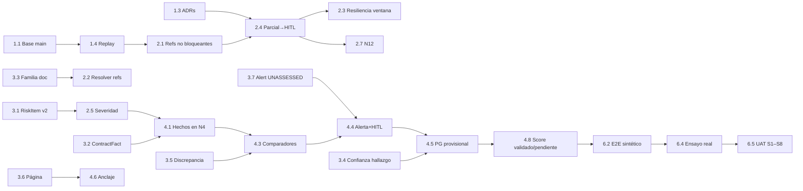

# C2Pro — WBS de implementación: reparación y mejora de orquestación, modelo de datos e integración

> **SUSTITUIDO (histórico).** CORE revisó este documento con el dictamen `PLAN_USEFUL / APPROVAL_WITHHELD` ([#1259 comentario 7021223373](https://github.com/AI-Gen-AI/C2Pro/issues/1259#issuecomment-7021223373)). La versión vigente es `C2PRO_E2E_REMEDIATION_WBS_V2_2026-11-19.md`. Esta v1 contiene errores reconocidos: tiene 40 WP y no 39, el corpus es de 6 documentos y no de 5, el calendario de 10 semanas no es realista, y propone retirar controles de reservas y fusionar en `main`, dos recomendaciones ya retiradas. Se conserva solo para la trazabilidad.

| Campo | Valor |
|---|---|
| Fecha | 2026-11-19 |
| Estado | **PROPUESTA** — no es autoridad de ejecución. Se convierte en trabajo canónico solo cuando el Planner/Orchestrator crea los sobres `.c2pro/work/<work_id>.yaml` y los ADR correspondientes son aceptados |
| Origen | `docs/audits/C2PRO_E2E_FUNCTIONAL_AUDIT_2026-11-19.md` (causas RC-01…RC-14) |
| Base de código | `799ce5315c01cdf6ec83f5716a02a509a6be1785` (runtime Railway `pilot`); `main` (`299aaf19`) es ancestro directo (0 commits por detrás, 707 por delante) |
| Objetivo | Que un contrato real + anexos + cronograma + presupuesto + especificación produzcan, de extremo a extremo, riesgos priorizados y citados, hechos contractuales, discrepancias con doble fuente, alertas, decisión HITL individual, ProjectGraph y Coherence/Health con validado vs pendiente, visibles en UI |

---

## 1. Principios de ejecución

1. **Reutilizar, no reescribir.** Se conservan: parser + N2, planificador de ventanas, ledger/recibos por ventana, RLS/fencing, HITL por hallazgo, comparadores deterministas, snapshot temporal, AlertGenerator.
2. **Replay offline antes de gasto.** Todo cambio de N4/N12 se valida primero reproduciendo artefactos reales ya pagados (paquete SEC 142 candidatos, N2 `cf8f4b7d…`) con proveedor *stub* determinista. Ninguna llamada facturable hasta el gate G4.
3. **Un dueño por fichero caliente.** `n4_*`, `nodes.py`, `workflow.py`, `project_graph*.py` y `alert_generator.py` tienen un único frente asignado por ola; las demás PR no los tocan.
4. **Cambios detrás de flag, por defecto compatibles**, con activación solo para el tenant piloto. Cada flag tiene fecha de retirada (WP 7.1).
5. **Honestidad de estado**: nada "desconocido" se representa como "bajo", "cero" o "completo". Se usa `UNASSESSED` con causa.
6. **Cada PR**: base exacta = SHA de integración vigente, CI verde en todos los jobs requeridos, revisión independiente, bloque `c2pro-implementation-result-v1` en el cuerpo.
7. **Arquitectura material ⇒ ADR antes del código** (WP 1.3).

---

## 2. Árbol WBS (niveles 1–3)

```
C2PRO-REM  Reparación E2E
├── 1 Base e integración
│   ├── 1.1 Línea base única en main
│   ├── 1.2 Manifiesto de release (web/API/worker/scheduler/migraciones/flags)
│   ├── 1.3 Paquete de ADR (033–037)
│   └── 1.4 Arnés de replay offline + corpus de aceptación
├── 2 Orquestación N4 / N12
│   ├── 2.1 Referencias cruzadas no bloqueantes
│   ├── 2.2 Resolución determinista de referencias
│   ├── 2.3 Ejecución resiliente por ventana
│   ├── 2.4 Propagación de resultado parcial (puente + routing)
│   ├── 2.5 Severidad y consecuencias propuestas
│   ├── 2.6 Consolidación / deduplicación entre ventanas
│   ├── 2.7 N12 redefinido (verificador por hallazgo + omisiones)
│   └── 2.8 Reproceso legítimo y guarda del bucle RETRY
├── 3 Modelo de datos
│   ├── 3.1 RiskItem v2
│   ├── 3.2 ContractFact (hechos contractuales tipados)
│   ├── 3.3 Familia documental (contrato ↔ anexos ↔ revisiones)
│   ├── 3.4 Confianza por hallazgo
│   ├── 3.5 CrossDocDiscrepancy (entidad persistente)
│   ├── 3.6 Mapa offset → página/bloque
│   └── 3.7 Semántica de severidad no evaluada en Alerts
├── 4 Integración
│   ├── 4.1 Extracción de hechos en la llamada N4 por ventana
│   ├── 4.2 Enrutado de especificaciones y anexos
│   ├── 4.3 Comparadores sobre hechos tipados
│   ├── 4.4 Discrepancia → Alerta + ítem HITL
│   ├── 4.5 ProjectGraph provisional sobre PROPOSED
│   ├── 4.6 Anclaje riesgo → cláusula → Coherence
│   ├── 4.7 Propuestas riesgo/hecho ↔ WBS
│   ├── 4.8 Coherence/Health validado vs pendiente
│   └── 4.9 Impacto de revisión (anexo revisado)
├── 5 API y UI
│   ├── 5.1 Read-models API
│   ├── 5.2 Panel de revisión (cobertura, severidad, página)
│   ├── 5.3 Vista de discrepancias de doble fuente
│   └── 5.4 Vista Coherence/Health validado vs pendiente
├── 6 Verificación y aceptación
│   ├── 6.1 Suite de replay N4/N12
│   ├── 6.2 E2E sintético 4 familias (stub)
│   ├── 6.3 Medición de recall/precisión con oráculo
│   ├── 6.4 Ensayo real acotado (gasto autorizado)
│   └── 6.5 UAT navegador S1–S8 con persona HITL real
└── 7 Simplificación y observabilidad
    ├── 7.1 Consolidación de flags
    ├── 7.2 Causa explícita de UNASSESSED/BLOCKED
    └── 7.3 Panel de resultados por etapa
```

Roles (`.claude/rules/agents.md`): **ORC** Orchestrator, **BE** Backend, **FE** Frontend, **FS** Full-Stack, **OPS** DevOps/Infra, **QA** Test/QA, **AUD** Verification Auditor, **REC** Reconciler. Esfuerzo en días-persona (dp).

---

## 3. Paquetes de trabajo detallados

### 1 — Base e integración

#### WP 1.1 Línea base única en `main` · ORC + OPS · 3 dp · RC-06
- **Alcance**: PR de `799ce531` → `main` (fast-forward lógico: `main` es ancestro). Inventario de PRs DRAFT (#1253–#1258, #1270, #1271, #1273, #1276, #1277): clasificar en *integrar ya*, *rebase sobre nueva base* o *cerrar con rationale*. Congelar nuevas cadenas apiladas: toda PR nueva parte del SHA de integración.
- **Ficheros**: ninguno de código; configuración de ramas y CI.
- **Aceptación**: `main` == SHA desplegado en Railway `pilot` (API, worker); CI requerido verde sobre ese SHA; lista de PRs con decisión registrada en el issue coordinador.
- **Riesgo**: CI de `main` no pasa sobre 707 commits → aislar fallos reales vs. jobs de entorno; no desactivar gates.

#### WP 1.2 Manifiesto de release · OPS · 2 dp · RC-06
- **Alcance**: fichero `ops/release-manifest.yaml` generado por CI con SHA de web, API, worker, scheduler, cabeza Alembic, cabeza Supabase y valores de flags `C2PRO_*` (nombres + valor, sin secretos). Endpoint `/health/version` que devuelve SHA.
- **Aceptación**: Vercel y Railway exponen el mismo SHA; el manifiesto se adjunta a cada ensayo.

#### WP 1.3 Paquete de ADR · ORC (redacta BE/FS, revisa AUD) · 5 dp
| ADR | Decisión | Desbloquea |
|---|---|---|
| ADR-033 | Semántica de cobertura N4: referencias abiertas ≠ ventana no examinada; resultado parcial se propaga a HITL con cobertura explícita | 2.1–2.4 |
| ADR-034 | Modelo `ContractFact` y familia documental | 3.2, 3.3, 4.1–4.3 |
| ADR-035 | Rol de N12: verificador por hallazgo + detector de omisiones; no juicio global | 2.7 |
| ADR-036 | Confianza por hallazgo y ProjectGraph provisional (no puntuado) sobre PROPOSED; enmienda ADR-026 / #714 | 3.4, 4.5, 4.8 |
| ADR-037 | Discrepancia transversal como entidad con Alerta + revisión HITL | 3.5, 4.4 |
- **Aceptación**: los cinco ADR en estado *Accepted* antes de fusionar código que dependa de ellos (los borradores pueden avanzar en paralelo).

#### WP 1.4 Arnés de replay offline y corpus · QA + BE · 6 dp · habilitador crítico
- **Alcance**:
  - `apps/api/tests/replay/` con proveedor *stub* que devuelve, por ventana, respuestas grabadas (`fixtures/replay/<doc_sha>/<window>.json`). Para el SEC se reconstruyen las respuestas desde el paquete de 142 candidatos (las `outstanding_references` originales no se archivaron: se generan sintéticas y se marcan como tales).
  - Corpus sintético EPC de 5 documentos (contrato, 2 anexos, cronograma XLSX, presupuesto XLSX, especificación) con **3 conflictos sembrados y documentados**: FAT anexo D vs cronograma D+21; terminación contrato vs fin cronograma +92 d; presupuesto = precio + 300.000 €.
  - Oráculo de verdad (`oracle.yaml`): riesgos esperados por cláusula, hechos esperados, discrepancias esperadas.
- **Aceptación**: `pytest apps/api/tests/replay -q` ejecuta el grafo completo N1→N16 sin red ni coste, y produce hoy el fallo actual reproducido (RED): 0 riesgos propagados.
- **Restricción**: los ficheros privados del SEC no se suben al repositorio; el replay del SEC corre solo en el VPS de QA con montaje de solo lectura.

### 2 — Orquestación N4 / N12

#### WP 2.1 Referencias cruzadas no bloqueantes · BE (dueño N4) · 3 dp · RC-01
- **Cambio**: en `n4_incremental_store.commit_window` (`:791-818`) el bloqueo depende solo de `incomplete_reason` (modelo informa `window_examined=false`); `unresolved_refs` se persiste igual (columna existente) pero la ventana queda `EXAMINED`. `N4WindowParsed.can_commit_as_examined` (`n4_compact_window_response.py:55-59`) deja de exigir lista vacía. `N4RunOutcome` añade `open_reference_windows` y `open_references_total`.
- **Sin migración de estado**: no se crea un valor nuevo (la columna es `varchar(16)` con CHECK); la información vive en `unresolved_refs`.
- **Flag**: `C2PRO_N4_REFS_NON_BLOCKING` (por defecto 1 en piloto, 0 en el resto hasta G2).
- **Tests**: replay SEC ⇒ 24/24 `EXAMINED`, run `COMPLETE`, referencias abiertas > 0 y expuestas; caso `window_examined=false` sigue `BLOCKED`; test PG real del ledger sin cambios de recibos.
- **Aceptación**: ninguna regresión en idempotencia/réplica; recibos idénticos.

#### WP 2.2 Resolución determinista de referencias · BE · 5 dp · RC-01
- **Alcance**: servicio `n4_reference_resolver` sin LLM: normaliza referencias ("cláusula 14.2", "Anexo III", "Schedule 4", "Section 7(b)") y las busca en la proyección N2 del propio documento y de los documentos de su familia (WP 3.3). Resultado por referencia: `RESOLVED_IN_DOCUMENT` (offset), `RESOLVED_IN_FAMILY` (doc/revisión/offset), `NOT_IN_PROJECT` (anexo no subido → **genera aviso de documento faltante**), `AMBIGUOUS`.
- **Integración**: se ejecuta tras el run N4 y antes del puente; el resultado viaja en `n4_incremental_window_coverage.references`.
- **Aceptación**: en el corpus sintético, 100 % de referencias internas resueltas; anexos ausentes producen aviso visible "documento referenciado no presente".

#### WP 2.3 Ejecución resiliente por ventana · BE · 4 dp · N4-D7
- **Cambio** en `n4_incremental_runner.run` (`:236-421`): `INVALID_PROVIDER_ENVELOPE` y `PROVIDER_MODEL_MISMATCH` bloquean **esa** ventana y el bucle continúa; presupuesto agotado, réplica en vuelo y `PROVIDER_RESULT_UNCERTAIN` siguen deteniendo el run (riesgo de doble cobro). Un reintento único por ventana con sobre inválido, con nueva reserva y clave de idempotencia derivada (`…:retry1`).
- **Aceptación**: replay con ventana 7 corrupta ⇒ 23/24 examinadas, 1 bloqueada con causa, candidatos de 23 ventanas disponibles; ningún recibo duplicado (test PG).

#### WP 2.4 Propagación de resultado parcial · BE · 4 dp · RC-02 · depende 2.1, ADR-033
- **Cambio**: `n4_governed_bridge.py:192-200` ya no lanza en `PARTIAL`; devuelve candidatos de ventanas examinadas + `risk_extraction_outcome = PARTIAL_UNASSESSED` + cobertura (`examined`, `total`, `blocked_ordinals`, `open_references`). `nodes.py:340-359` solo marca fallo honesto si **0 ventanas examinadas**. `route_after_risk_extraction` (`workflow.py:71-72`) termina solo en ese caso.
- **Reglas**: `human_approval_required=True` siempre que la cobertura no sea total; la UI debe poder mostrar "analizado X de Y".
- **Aceptación**: replay SEC (sin WP 2.1) ⇒ 142 candidatos llegan a N12/N13 con estado parcial; con WP 2.1 ⇒ estado completo; checkpoint HITL creado (test PG).

#### WP 2.5 Severidad y consecuencias propuestas · BE · 5 dp · RC-03 · depende 3.1
- **Cambio**: prompt `n4-compact-window-v2` añade por hallazgo `severity_proposed` (critical/high/medium/low/UNASSESSED), `likelihood_proposed`, `consequence` (texto), `impact_type` (coste/plazo/alcance/calidad/legal/HSE), `severity_rationale` anclado a la cita. `parse_n4_window_output` valida enumeraciones. `_candidate_payload` (`n4_governed_bridge.py:112-145`) los mapea a RiskItem v2 conservando el estado "propuesto, no verificado". El `config_sha256` cambia con la versión de prompt (los runs antiguos no se mezclan).
- **Aceptación**: en replay, 100 % de candidatos con severidad propuesta o `UNASSESSED` explícito; ninguna alerta generada con LOW por defecto (ver 3.7).

#### WP 2.6 Consolidación entre ventanas · BE · 3 dp · N4-H3
- **Alcance**: post-proceso determinista que agrupa candidatos con solape de span ≥ 50 % o misma cita normalizada; conserva todos los `finding_key` como miembros de un grupo (no borra evidencia).
- **Aceptación**: informe de duplicados en replay SEC; la UI muestra 1 riesgo con N evidencias.

#### WP 2.7 N12 redefinido · BE · 8 dp · RC-04 · depende ADR-035, 2.4
- **Fase A (2 dp, inmediata)**: corregir atestación (`n12_source_attestation.py:31-34`) para comparar hash de `parsed_text` + registro de redacciones N2, no igualdad de cadenas; registrar la excepción en `ai_extraction.py:195-196`; flag `C2PRO_N12_MODE=off|legacy|per_finding` (por defecto `off` en contratos hasta fase B).
- **Fase B (6 dp)**: modo `per_finding`: lotes de ≤20 hallazgos con su cita ±1.500 chars de contexto; salida estructurada por `finding_key`: `SUPPORTED | NOT_SUPPORTED | SEVERITY_DISPUTED | NEEDS_CONTEXT` + cita. Detector de omisiones **determinista**: lista de secciones/cláusulas de N2 (encabezados numerados) sin ningún candidato ni hecho → `coverage_gaps` para HITL. Los veredictos se guardan junto al hallazgo (3.4) y nunca aprueban.
- **Aceptación**: replay con stub ⇒ cada hallazgo tiene veredicto o `UNASSESSED` con causa; coste por documento ≤ coste N4 (lotes acotados, sin reenviar documento completo).

#### WP 2.8 Reproceso legítimo y guarda RETRY · BE + OPS · 3 dp · RC-05, N4-H4
- **Alcance**: (a) runbook `docs/runbooks/n4-reprocess-new-generation.md` con la ruta oficial (nueva revisión/generación) que satisface la guarda ANY-RUN sin SQL manual; (b) test que demuestra si `critique → risk_extractor` crea un run nuevo; si lo hace, el reintento reutiliza el run existente (los `EXAMINED` no se vuelven a llamar).
- **Aceptación**: documento UAT relanzable en preview sin reset; 0 llamadas duplicadas en reintento.

### 3 — Modelo de datos

#### WP 3.1 RiskItem v2 · BE · 3 dp
- **Campos nuevos** en `analysis/domain/contracts.py` (aditivos, opcionales): `finding_key`, `group_key`, `severity_proposed`, `likelihood_proposed`, `severity_status` (`PROPOSED|VERIFIED|UNASSESSED`), `consequence`, `impact_type`, `source_span` [inicio, fin], `source_page`, `window_ordinal`, `n12_verdict`, `review_state`. `impact` legado se marca *deprecated*.
- **Compatibilidad**: `DocumentArtifact` antiguo sigue validando; serialización JSON en `document_artifacts` sin migración (JSONB).
- **Aceptación**: tests de contrato v1/v2; read-model HITL (`review_findings_view.py`) muestra campos v2.

#### WP 3.2 ContractFact · BE · 6 dp · RC-07 · ADR-034
- **Entidad**:
  - `fact_type`: `COMPLETION_DATE, MILESTONE, CONTRACT_PRICE, PAYMENT_TERM, LIQUIDATED_DAMAGES, WARRANTY, GUARANTEE_BOND, OBLIGATION, EXCLUSION, SCOPE_ITEM, TECHNICAL_REQUIREMENT, ACCEPTANCE_TEST`
  - `milestone_kind` (FAT, SAT, MECHANICAL_COMPLETION, COMMISSIONING, PROVISIONAL_ACCEPTANCE, FINAL_ACCEPTANCE, OTHER)
  - valor tipado: `value_date` | `value_relative` (`{n, unit, anchor}`) | `value_amount` + `currency` | `value_percent` | `value_text`
  - procedencia: `tenant_id, project_id, document_id, revision_id, source_span, source_page, clause_ref, source_quote, quote_status, finding_key`
  - estado: `PROPOSED | VERIFIED | REJECTED | SUPERSEDED`
- **Persistencia**: tabla `contract_facts` (Alembic + espejo Supabase, **RLS tenant obligatoria**, índice por `project_id, fact_type`); también incrustada en `DocumentArtifact.contract_facts`.
- **Aceptación**: migración up/down en PG real; test de aislamiento cross-tenant; `make openapi` regenerado.

#### WP 3.3 Familia documental · BE · 4 dp · RC-11
- **Campos** en `documents`: `document_role` (`MAIN_CONTRACT, ANNEX, AMENDMENT, TECHNICAL_SPEC, SCHEDULE, BUDGET, OTHER`), `parent_document_id` (nullable, mismo proyecto), `annex_label`. Revisión: `supersedes_revision_id` (si no existe ya).
- **UI**: al subir, el usuario elige rol y contrato padre (sugerencia automática por nombre de fichero/encabezado).
- **Aceptación**: RLS + FK mismo proyecto; resolver de referencias (2.2) usa la familia.

#### WP 3.4 Confianza por hallazgo · BE · 5 dp · RC-09 · ADR-036
- **Alcance**: estado por hallazgo/hecho (`PROPOSED/ACCEPTED/REJECTED/CORRECTED`) derivado de las decisiones existentes de `finding_decision_router` (no crear otro flujo). El artefacto documento pasa a TRUSTED como hoy; además, los hallazgos ACCEPTED son consultables individualmente aunque el documento siga en revisión.
- **Regla**: aceptar un riesgo = "reconocido", **no** "eliminado"; no aumenta Coherence.
- **Aceptación**: decisión individual + readback tras relogin; ninguna promoción en bloque.

#### WP 3.5 CrossDocDiscrepancy · BE · 4 dp · RC-08 · ADR-037
- **Tabla** `cross_doc_discrepancies`: `rule_id`, `fingerprint` (único por proyecto), `sources[]` (≥2: doc, revisión, localizador, cita/hash de fila), `compared_values`, `delta`, `unit`, `severity_proposed`, `state` (`OPEN/CONFIRMED/DISMISSED/RESOLVED/STALE`), `alert_id`, `review_item_id`, `first_seen_snapshot_id`, `last_seen_snapshot_id`. RLS.
- **Compatibilidad**: se sigue emitiendo `project_graph.source_discrepancies_observed` (auditoría), pero la fuente de verdad pasa a la tabla.
- **Aceptación**: misma discrepancia en dos ejecuciones ⇒ 1 fila; cambio de revisión de una fuente ⇒ `STALE` + nueva evaluación.

#### WP 3.6 Mapa offset → página · BE · 4 dp · RC-12
- **Alcance**: N1 persiste `page_offsets` (offset inicial de cada página en `parsed_text`) a partir de los bloques PyMuPDF; N2 genera mapa de desplazamientos por redacción para traducir offsets N2→parsed. Función `locate(span) -> (page, bbox?)`.
- **Aceptación**: el 100 % de citas verificadas del corpus tiene página correcta (comparación manual de 20 muestras).

#### WP 3.7 Severidad no evaluada en Alerts · BE · 2 dp · RC-03
- **Cambio**: `alert_generator.py:330-352` deja de devolver LOW por defecto; columna `severity_assessment` (`ASSESSED|UNASSESSED`) en alerts (migración aditiva + RLS sin cambios) y severidad de visualización "Sin evaluar". SLA no se calcula para `UNASSESSED` (o usa política explícita).
- **Aceptación**: test: riesgo sin severidad ⇒ alerta `UNASSESSED`, nunca LOW.

### 4 — Integración

#### WP 4.1 Hechos en la llamada N4 · BE · 5 dp · depende 3.2, 2.5
- **Cambio**: el prompt v2 devuelve `findings[]` **y** `facts[]` en la misma llamada por ventana (sin coste extra de entrada; salida ~+30 %). Parser valida tipos; fechas normalizadas en servidor (no por el modelo) con cita literal obligatoria.
- **Aceptación**: en el corpus, hechos esperados del oráculo extraídos con recall ≥ 90 % y 0 hechos sin cita.

#### WP 4.2 Enrutado de especificaciones y anexos · BE · 3 dp · RC-11
- **Cambio** en `workflow.py:336-350`: `technical_spec/specification` ⇒ N5 (WBS) **y** extracción de hechos (`TECHNICAL_REQUIREMENT`, `ACCEPTANCE_TEST`, `MILESTONE`) mediante el mismo runner de ventanas con perfil de prompt "spec". Anexos con `document_role=ANNEX` se tratan como contrato.
- **Aceptación**: requisito FAT de la especificación del corpus aparece como hecho con fecha y cita.

#### WP 4.3 Comparadores sobre hechos · BE · 6 dp · RC-08 · depende 3.2, 3.5, 4.1
- **Cambio**: `structured_source_comparison.compare_original_source_rows` consume `ContractFact` en lugar de regex sobre citas de riesgos (las regex quedan como respaldo marcado). Reglas:
  | Regla | Comparación |
  |---|---|
  | `COMPLETION-VS-SCHEDULE` | `COMPLETION_DATE` vs fin máximo cronograma |
  | `MILESTONE-VS-SCHEDULE` | `MILESTONE(kind)` contrato/anexo/spec vs actividad del cronograma emparejada por `milestone_kind` + similitud de nombre; ambigüedad ⇒ `UNASSESSED` |
  | `PRICE-VS-BUDGET` | `CONTRACT_PRICE` vs total presupuesto (misma moneda) |
  | `SPEC-VS-CONTRACT-MILESTONE` | mismo hito con fechas distintas entre documentos de la familia |
  | `PAYMENT-MILESTONE-VS-SCHEDULE` | hito de pago ligado a evento sin actividad equivalente |
- Fechas: ISO, `dd/mm/aaaa`, `d de mes de aaaa`, `Month d, yyyy`; plazos relativos se resuelven solo si existe fecha ancla verificada, si no `UNASSESSED`.
- **Aceptación**: los 3 conflictos sembrados detectados con ambas fuentes; 0 falsos positivos en el corpus limpio.

#### WP 4.4 Discrepancia → Alerta + HITL · BE · 5 dp · depende 3.5, 3.7
- **Cambio**: por cada discrepancia nueva u modificada, `AlertGenerator` crea/actualiza 1 alerta con las dos procedencias; se crea un ítem de revisión enlazado (reutilizar `finding_decision_router` con tipo `DISCREPANCY`). `alert_correlation` y `hitl_routing` de ProjectGraph (`project_graph.py:1065-1135`) dejan de quedar en SKIPPED.
- **Aceptación**: decisión humana `CONFIRMED/DISMISSED` con readback; la alerta refleja el estado.

#### WP 4.5 ProjectGraph provisional · BE · 6 dp · RC-09 · ADR-036
- **Cambio**: `run_project_graph_once` (`project_graph_tasks.py:182-330`) acepta `trust_scope = TRUSTED | PROVISIONAL`. `PROVISIONAL` carga artefactos PROPOSED de la revisión vigente, ejecuta alineación, comparadores, discrepancias y alertas, pero **no** escribe Coherence/Health canónicos ni proyecciones TRUSTED; snapshot marcado `provisional=true`. Se dispara al completar el grafo por documento (hook `document_artifact_completion.py:76-83` hoy solo encola en TRUSTED).
- **Flag**: `feature_v3_project_graph` activado solo para tenant piloto.
- **Aceptación**: con el corpus sin aprobar ⇒ discrepancias y alertas visibles; tras aprobar ⇒ ejecución TRUSTED con score.

#### WP 4.6 Anclaje riesgo → cláusula · BE · 3 dp · RC-10 · depende 3.6
- **Cambio**: usar `source_refs.analysis_span` de N4 para resolver `clause_id` físico (cargador `load_trusted_risk_source_clause_ids`) en lugar de requerir hash de cita externo; riesgos anclados entran en señales de Coherence (`project_graph.py:229-275`).
- **Aceptación**: `dropped_reasons.quote_not_independently_verified` = 0 para riesgos con cita verificada.

#### WP 4.7 Propuestas riesgo/hecho ↔ WBS · BE · 5 dp · P2 dentro de la ola 4
- **Alcance**: reutilizar servicios de propuestas WBS (ADR-030): sugerir vínculos hito/obligación/riesgo → nodo WBS por similitud + regla de tipo; solo propuestas, aprobación humana.
- **Aceptación**: discrepancia FAT del corpus enlazada (propuesta) a la actividad WBS FAT.

#### WP 4.8 Coherence/Health validado vs pendiente · BE · 4 dp
- **Cambio**: `ProjectCoherenceResult` y snapshot exponen `score_validated` (solo TRUSTED/ACCEPTED), `score_provisional`, `pending_items`, `coverage`; Health declara dimensiones con `NULL` + razón. Aceptar un riesgo no modifica el score.
- **Aceptación**: tests de propiedad: ack ⇒ score igual; rechazar discrepancia ⇒ deja de penalizar en provisional.

#### WP 4.9 Impacto de revisión · BE · 5 dp · posterior
- **Alcance**: al llegar nueva revisión de un anexo, diff de `ContractFact` (añadidos/modificados/eliminados) usando `change_intelligence` existente; discrepancias afectadas pasan a `STALE`; decisiones previas marcadas para revisión.
- **Aceptación**: revisión del anexo de hitos con FAT movido ⇒ discrepancia recalculada y decisión previa señalada.

### 5 — API y UI

| WP | Rol | dp | Alcance | Aceptación |
|---|---|---|---|---|
| 5.1 Read-models | BE | 4 | GET hallazgos v2 con cobertura y grupos; GET `contract-facts`; GET `discrepancies` con dos fuentes; todos tenant-scoped; OpenAPI regenerado | Contratos OpenAPI + tests de autorización cross-tenant |
| 5.2 Panel de revisión | FE | 5 | `ReviewFindingsPanel`: banner "analizado X/Y ventanas, N referencias abiertas, M anexos ausentes"; severidad propuesta + justificación; enlace a página; veredicto N12; acciones individuales | Vitest + Playwright con MSW; sin aprobación en bloque |
| 5.3 Vista discrepancias | FE | 5 | Página `projects/[id]/coherence`: tabla de discrepancias, vista lado a lado de ambas fuentes con cita/fila, delta, decisión | Playwright: confirmar/descartar y recargar |
| 5.4 Coherence/Health | FE | 3 | Mostrar validado vs provisional vs pendiente; `NULL` con razón | Snapshot tests + revisión UX |

### 6 — Verificación y aceptación

| WP | Rol | dp | Alcance | Aceptación |
|---|---|---|---|---|
| 6.1 Suite replay | QA | 4 | Casos RED→GREEN para RC-01…RC-04 sobre 1.4 | Verde en CI (replay SEC en VPS QA, corpus sintético en CI) |
| 6.2 E2E sintético | QA + FS | 5 | Corpus 5 docs, PG + Redis + worker Celery reales, proveedor stub, N1→ProjectGraph→alertas→HITL→score | Los 3 conflictos llegan a UI; readback tras relogin |
| 6.3 Recall/precisión | QA + AUD | 4 | Oráculo humano 20 cláusulas sobre paquete SEC + corpus | Informe con recall/precisión por categoría; umbral de aceptación lo fija CORE |
| 6.4 Ensayo real acotado | ORC + OPS | 3 | Corpus real autorizado, gasto aprobado explícitamente | Evidencias del plan de aceptación de la auditoría (Entregable 7) |
| 6.5 UAT navegador | QA + persona HITL | 3 | S1–S8 con vídeo/trace, segunda pasada con IDs nuevos | Dictamen PASS/PASS_LIMITED/FAIL por AUD |

### 7 — Simplificación y observabilidad

| WP | Rol | dp | Alcance | Aceptación |
|---|---|---|---|---|
| 7.1 Flags | OPS + BE | 3 | Inventario `C2PRO_N4_*`, `C2PRO_N12_*`, `C2PRO_SKIP_HITL`, `feature_v3_*`; perfil único `C2PRO_ANALYSIS_PROFILE=pilot|prod`; fecha de retirada por flag | Tabla de flags en runbook; validador en arranque |
| 7.2 Causas explícitas | BE | 2 | Todo `UNASSESSED`/`BLOCKED`/`SKIPPED` con `reason_code` enumerado y log estructurado | Ningún `except: pass` en `analysis/` (lint) |
| 7.3 Panel por etapa | OPS + FE | 4 | Página interna `observability`: por documento, estado N1…N17 y ProjectGraph, cobertura, coste, causas | Visible para el documento del ensayo 6.4 |

---

## 4. Dependencias, olas y camino crítico

### 4.1 Olas (inicio estimado 23/11/2026; 1 dueño por frente)

| Ola | Semanas | Frente A (N4/N12, BE) | Frente B (modelo/integración, BE) | Frente C (UI, FE) | Frente D (QA/OPS) | Gate de salida |
|---|---|---|---|---|---|---|
| 0 | S1 | — | ADR 033–037 (borradores) | — | 1.1, 1.2, 1.4 | **G0** línea base única + arnés RED |
| 1 | S1–S3 | 2.1 → 2.4 → 2.3, 2.7-A | 3.1, 3.7, 3.3 | 5.2 (cobertura, severidad) | 6.1, 2.8 | **G1** replay SEC: 142 candidatos en HITL, severidad propuesta, 0 LOW por defecto |
| 2 | S3–S5 | 2.5, 2.2, 2.6 | 3.2, 3.5, 3.6 | 5.1 | 7.2, 7.1 | **G2** cobertura completa con referencias; modelo de datos migrado en PG |
| 3 | S5–S7 | 4.1, 4.2, 2.7-B | 4.3, 4.4, 4.6 | 5.3 | 6.2 | **G3** E2E sintético: 3 conflictos detectados, alertados y revisables |
| 4 | S7–S9 | soporte | 4.5, 4.8, 3.4 | 5.4 | 6.3, 7.3 | **G4** ProjectGraph provisional + score validado/pendiente; recall medido |
| 5 | S9–S10 | — | 4.7 | — | 6.4, 6.5 | **G5** UAT real S1–S8 → decisión GO piloto |
| 6 | S10+ | — | 4.9 | — | — | Revisión de anexos |

### 4.2 Diagrama de dependencias



### 4.3 Camino crítico
`1.1 → 1.4 → 2.1 → 2.4 → 2.5 → 4.1 → 4.3 → 4.4 → 4.5 → 4.8 → 6.2 → 6.4 → 6.5` ≈ **58 dp en serie**: ~12 semanas si cada paquete del camino lo hace una sola persona; ~10 semanas si 4.3/4.4 y 4.5/4.8 se reparten entre dos personas de los frentes A y B, como asume la tabla 4.1. Cualquier retraso de 1.1 (CI sobre 707 commits) o de los ADR desplaza todo el plan.

### 4.4 Esfuerzo total
| Bloque | dp |
|---|---|
| 1 Base | 16 |
| 2 Orquestación | 35 |
| 3 Modelo de datos | 28 |
| 4 Integración | 42 |
| 5 API/UI | 17 |
| 6 Verificación | 19 |
| 7 Simplificación | 9 |
| **Total** | **≈166 dp** (≈ 4 personas × 10 semanas, con 15 % de contingencia incluido en el camino crítico, no en el total) |

---

## 5. Gates y criterios de salida

| Gate | Evidencia obligatoria | Quién dictamina |
|---|---|---|
| G0 | `main` == SHA desplegado; manifiesto; suite replay ejecuta y falla por las causas RC-01/02 (RED documentado) | ORC + AUD |
| G1 | Replay SEC: 142 candidatos (o grupos) en checkpoint HITL; cobertura visible; 100 % severidad propuesta o UNASSESSED; 0 recibos duplicados en test PG | AUD |
| G2 | Replay SEC 24/24 EXAMINED con referencias abiertas listadas; migraciones `contract_facts`, `cross_doc_discrepancies`, familia documental, `severity_assessment` aplicadas en PG desechable con RLS probada | AUD |
| G3 | E2E sintético con worker real: FAT +21 d, terminación +92 d, presupuesto +300.000 € detectados con dos fuentes, alerta y ítem HITL; decisión con readback | QA + AUD |
| G4 | ProjectGraph provisional y TRUSTED ejecutados; score validado ≠ provisional; ack no sube score; informe de recall/precisión | AUD + CORE |
| G5 | Ensayo real autorizado + UAT navegador S1–S8 con persona HITL real; dictamen por dimensión | CORE |

Ningún gate se aprueba con CI verde o tests stub solamente; cada gate requiere la evidencia de su fila.

---

## 6. Coste de inferencia previsto (solo a partir de G4)

| Concepto | Base histórica | Estimación |
|---|---|---|
| N4 por contrato de ~24 ventanas | $0,39 (SEC real) | $0,50–0,70 con hechos y severidad (+30–50 % salida) |
| N12 por hallazgo (lotes de 20) | sin dato real | ≈ $0,15–0,30 por contrato |
| Corpus de aceptación (5 documentos) | — | ≈ $2–4 |

El tope de tenant observado ($5) cubre un ensayo pero no reintentos: OPS debe reconciliar saldo y reservas antes de G5 (WP 2.8).

---

## 7. Riesgos del plan

| Riesgo | Prob. | Impacto | Mitigación |
|---|---|---|---|
| CI de `main` no converge sobre 707 commits | Media | Alto | Fallos de entorno aislados en issue propio; ningún gate debilitado |
| Expansión de ADR/gobernanza retrasa código | Alta | Alto | ADR breves (≤2 páginas), 5 días máximo, código detrás de flag en paralelo |
| Recall de hechos insuficiente | Media | Alto | Medición temprana 6.3 sobre corpus; ajuste de prompt antes de G5 |
| Emparejamiento hito↔actividad ambiguo | Alta | Medio | `UNASSESSED` explícito + propuesta HITL, nunca adivinar |
| Conflicto de ficheros entre frentes | Media | Medio | Dueño único por fichero caliente (principio 3) |
| Datos confidenciales en fixtures | Baja | Alto | Corpus sintético en repo; SEC solo en VPS QA de solo lectura |

---

## 8. Propuesta de sobres de trabajo (para el Planner)

El worker no puede crear sobres en `.c2pro/work/` (autoridad única del Planner/Orchestrator). Se proponen así, con `forbidden_paths` que impiden solapes:

| Sobre propuesto | WP | Rol / modelo asignado (roster vigente) | Ficheros permitidos (resumen) | Prohibidos clave |
|---|---|---|---|---|
| REM-01 | 1.1, 1.2 | DevOps/Infra · Codex | CI, `ops/` | `apps/api/src/**` |
| REM-02 | 1.4, 6.1 | Test/QA · DeepSeek | `apps/api/tests/replay/**`, fixtures | `apps/api/src/**` |
| REM-03 | 2.1, 2.3, 2.4, 2.8 | Backend · Codex/Sonnet | `analysis/application/n4_*`, `analysis/adapters/persistence/n4_*`, `analysis/adapters/graph/n4_governed_bridge.py`, `nodes.py` (solo N4), `workflow.py` | `coherence/**`, `alerts/**` |
| REM-04 | 2.5, 2.6, 3.1, 4.1, 4.2 | Backend · Sonnet | `analysis/domain/n4_*`, `contracts.py`, prompts | `n4_incremental_store.py` |
| REM-05 | 2.7 | Backend · Codex | `analysis/domain/ai_extraction.py`, `critique_*`, `n12_*` | N4 |
| REM-06 | 3.2, 3.3, 3.5, 3.6, 3.7 | Backend · Codex | Alembic + Supabase, `documents/**`, `alerts/**` (3.7) | `analysis/adapters/graph/**` |
| REM-07 | 4.3, 4.4, 4.5, 4.6, 4.8 | Full-Stack · Codex | `analysis/adapters/graph/project_graph*.py`, `structured_source_comparison.py`, `core/tasks/project_graph_tasks.py`, `coherence/alert_generator.py` | N4/N12 |
| REM-08 | 5.1–5.4 | Frontend · Sonnet (5.1 Backend) | `apps/web/**`, routers de lectura | dominio |
| REM-09 | 6.3, auditorías de gate | Verification Auditor · Gemini | solo lectura | todo |
| REM-10 | 7.1–7.3 | DevOps/Infra · Codex | config, observabilidad | dominio |

Actualizaciones de backlog/estado: solo vía Reconciler (Haiku) tras merge y reconciliación.
