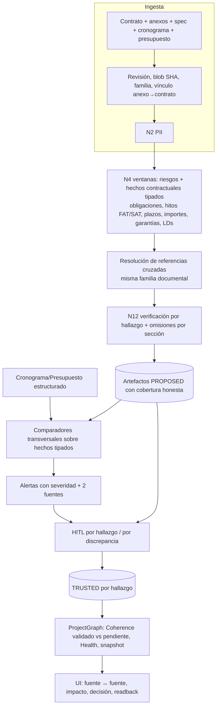
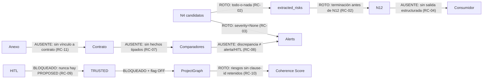

# C2Pro — Auditoría independiente técnica y funcional del Complete Journey

| Campo | Valor |
|---|---|
| Fecha | 2026-11-19 |
| Tipo | Auditoría fechada (evidencia histórica, `docs/audits/`) — **no** es autoridad de estado de producto ni de ejecución |
| Alcance | Complete Journey S1–S8, N1–N17, N4/N12, ProjectGraph, coherencia transversal, HITL, Alerts, Health, Coherence Score |
| Método | Lectura estática de código + issues/PRs/documentos de evidencia. **Sin** llamadas IA facturables, sin acceso a UAT/producción, sin SQL, sin despliegues ni merges |
| Autor | Auditoría independiente asistida por IA (rol: Verification Auditor, solo lectura) |

---

## 0. Revisiones auditadas (verificación de HEAD)

Primer hallazgo, previo a cualquier análisis funcional: **`main` no es el código que se ejecuta**.

| Línea | SHA | Relación con `main` (`299aaf19`) | Uso |
|---|---|---|---|
| `main` | `299aaf19f5025a2162c6a2c626542f6dd472c3c6` | — | Rama por defecto (último merge: #1134) |
| `feat/c2pro-core-pilot-20261104` | `e19fa98d…` | +432 commits, 0 detrás | Vercel producción `v0-c2-pro` (según #1259) |
| `release/core-candidate-20261108` | `5af16eed…` | +580 commits | Railway piloto (según #1259, 17/11) |
| `fix/uat-n4-inherit-budget-scopes-20261118` | `799ce5315c01cdf6ec83f5716a02a509a6be1785` | +707 commits | **Railway `pilot` API+Worker desplegado** (según #1259 comentario 7020013876, 19/11) |
| PRs DRAFT apiladas | #1253→#1254→#1256→#1257→#1258, #1255, #1270, #1271, #1273, #1276, #1277 | ninguna fusionada | Frentes A/B/D/E |

**Todas las referencias de código de este informe apuntan a `799ce531` (runtime UAT)** salvo indicación contraria. Las afirmaciones sobre despliegues proceden de #1259 (no verificadas directamente: el auditor no tiene acceso de lectura a Railway/Vercel en esta sesión → `NOT_VERIFIED`).

---

## Adenda 2026-11-19 — Rectificaciones tras revisión CORE

CORE revisó este informe ([#1259 comentario 7020970699](https://github.com/AI-Gen-AI/C2Pro/issues/1259#issuecomment-7020970699)) y lo aceptó como *diagnóstico útil con rectificaciones*. El auditor ha contrastado cada una contra el código `799ce531` y las acepta. **Esta adenda prevalece sobre el texto original** donde difieran. El texto original se mantiene para conservar la trazabilidad.

| Hallazgo | Formulación original | Rectificación aceptada | Comprobación del auditor |
|---|---|---|---|
| RC-01 | "N4 nunca puede completar un contrato real" | **Confirmado, con alcance acotado.** Una ventana sin `outstanding_references` sí puede quedar `EXAMINED`. El defecto es que una referencia pendiente bloquea una ventana ya leída y facturada. Ninguna corrección puede marcar referencias como resueltas sin enlazar la fuente original. | `can_commit_as_examined` exige solo `reported_examined and not outstanding_references` (`n4_compact_window_response.py:55-59`). Con lista vacía la ventana se examina. |
| RC-02 | — | **Confirmado.** Matiz: los candidatos persistidos en `n4_candidate_findings` no se borran; lo que se vacía es el estado del grafo. #1276 (DRAFT) añade una lectura GET de hallazgos PROPOSED parciales. | `test_g2_n4_partial_read_p1.py` en `pr/1276`. |
| RC-03 | — | **Confirmado.** Desconocido no es LOW. La corrección **no** debe asignar CRITICAL automáticamente. | — |
| RC-04 | "N12 está construido para devolver UNASSESSED" | **Confirmado en parte.** N12 puede devolver `OK` si la fuente está íntegra y atestada. `critique_node` conserva `critique_notes` y exige HITL. `UNASSESSED` es un estado de protección legítimo. El defecto real es que N12 no aporta una evaluación estructurada útil y que la atestación no contempla la redacción PII. Hace falta una atestación separada (parser original / proyección N2 / localizadores). No vale comparar hashes para "saltarse" la redacción. | `ai_extraction.py:181-187` (ruta `OK`); `nodes.py:754-757`. |
| RC-08 | "El caso FAT del contrato vs cronograma no está cubierto" | **Corregido.** La regla `SPEC-MILESTONE-VS-SCHEDULE` **existe** en `structured_source_comparison.py` (cita de especificación + fila de cronograma + `overrun_days`). Falta demostrar que recibe las dos fuentes originales y que su resultado PROVISIONAL llega a Alerts/HITL. **No hay que construir otro comparador FAT**: hay que alimentar e integrar el existente. La parte vigente del hallazgo es que el **contrato y los anexos** no aportan hitos tipados a esa regla. | La regla solo considera citas de documentos `technical/specification` (`_quoted_risks(..., technical=True)`). |
| RC-09 | — | **Matiz aceptado.** TRUSTED-only protege el estado canónico y **no** debe relajarse. Cualquier ejecución sobre PROPOSED debe vivir en un plano PROVISIONAL separado, sin Score validado ni promoción. | — |
| RC-06 / P0-5 | "Línea de integración única → `main`" | **Reformulado.** Que `main` sea ancestro del runtime solo prueba que el *fast-forward* es posible en Git. No prueba compatibilidad de CI, seguridad, frontend, flags ni migraciones. La acción pasa a ser: inventario de SHAs, manifiesto y **propuesta** de baseline candidata bajo un gate independiente. Nada de fusionar por decreto. | — |
| RC-14 / P2-3 | "Simplificar gobernanza: presupuesto por run + idempotencia" | **Retirado.** Eliminar controles del sistema de reservas podría permitir gastos duplicados. Se mantiene solo una recomendación de observabilidad: que cada bloqueo explique su causa. | — |
| Plan de aceptación | "5 documentos" | El corpus son **6 documentos de 4 familias**. | — |

**Invariantes vigentes** (CORE): `N4_BILLABLE=STOP`, `N12_BILLABLE=STOP`, `MERGE=STOP`, `UAT_DEPLOY=STOP`. La hoja de ruta de este informe es orientativa. El plan corregido está en `docs/architecture/proposals/C2PRO_E2E_REMEDIATION_WBS_2026-11-19.md` (v2).

---

## Entregable 1 — Veredicto ejecutivo

### Conclusión en una frase
C2Pro **no entrega inteligencia de proyecto porque su cadena de integración descarta el trabajo que la IA sí realiza**: N4 genera candidatos sobre el contrato completo, pero un diseño de ledger "todo o nada" los convierte en cero riesgos, termina el grafo antes de N12/HITL, y por tanto nada llega nunca a estado TRUSTED, que es la única puerta de entrada a ProjectGraph, Coherence, Health y la inteligencia transversal. El problema principal **no es el razonamiento del modelo**; es **orquestación + modelo de datos + integración**, agravado por una fragmentación de código (707 commits fuera de `main`, ~10 PRs DRAFT apiladas) y una capa de gobernanza de costes/atestaciones que ha crecido más rápido que la capacidad funcional.

### Por qué no se obtienen los resultados esperados (causas confirmadas, en orden de impacto)

1. **Una referencia cruzada pendiente bloquea ventanas N4 ya leídas y facturadas (RC-01, CONFIRMADO con alcance acotado — ver adenda).** El prompt de ventana pide `outstanding_references` (referencias cruzadas no resueltas). Cualquier contrato EPC real cita cláusulas y anexos en casi cada ventana. `commit_window()` marca la ventana `BLOCKED` si esa lista no está vacía, y no existe ningún paso que resuelva las referencias. Resultado histórico real: **24/24 ventanas facturadas y liquidadas, 142 candidatos persistidos, 0 ventanas `EXAMINED`, run `PARTIAL`** (SEC run #44007355327).
2. **El puente N4→grafo es "todo o nada" (RC-02, CONFIRMADO).** Si el run no es `COMPLETE`, `run_governed_n4_in_graph` lanza excepción, N4 se marca como fallo, `extracted_risks=[]`, `workflow_terminated=True` → **END**. N12, HITL, N8, N10, N11, N17 y ProjectGraph no se ejecutan. Los 142 candidatos quedan varados en `n4_candidate_findings`, solo accesibles con scripts offline.
3. **N12 no aporta una evaluación útil y queda `UNASSESSED` en la práctica (RC-04, CONFIRMADO EN PARTE — ver adenda).** Exige que `document_text == texto anonimizado` (imposible en cuanto N2 redacta un solo dato personal), convierte cualquier hallazgo del crítico en `UNASSESSED`, y traga excepciones con `except Exception: pass`. N12 no produce salida estructurada que consuma ningún componente: es coste sin valor de decisión.
4. **N4 gobernado borra la severidad (RC-03, CONFIRMADO).** `severity`, `likelihood` y `confidence` se fijan a `None` y el campo `impact` del modelo se descarta; el `AlertGenerator` convierte "sin severidad" en **LOW**. Un riesgo crítico se presentaría como bajo; la priorización es imposible.
5. **La inteligencia transversal no tiene un modelo de datos que la sostenga (RC-07/RC-08, CONFIRMADO).** El contrato solo produce `RiskItem` (sin obligaciones, hitos, fechas, importes, garantías, FAT/SAT). Los únicos comparadores transversales operativos son 3 reglas regex que buscan una fecha/importe dentro de las **citas de riesgos** del contrato, comparadas contra filas **XLSX** de cronograma/presupuesto. La regla `SPEC-MILESTONE-VS-SCHEDULE` (especificación vs cronograma) existe; lo que falta es que el contrato y los anexos le aporten hitos tipados y que su resultado llegue a Alerts/HITL (ver adenda). Las discrepancias se guardan como `project_event` provisional, **no** como alertas ni ítems HITL.
6. **Dependencia circular de confianza (RC-09, CONFIRMADO).** ProjectGraph consume solo artefactos `TRUSTED`; `TRUSTED` requiere aprobación HITL; HITL requiere que N4 complete; N4 no completa. Con la configuración actual, ProjectGraph está estructuralmente vacío para contratos reales.

### Qué funciona (con evidencia)
- **Parsing + N2 + planificación de ventanas**: proyección N2 verificada por hash (46/46 contextos válidos, 0 huecos, 3 redacciones PII) sobre documento UAT real — #1259 comentario 7020198639 / #1260.
- **Llamadas N4 multi-ventana y ledger de costes**: 24/24 recibos `SETTLED`, 62.103/26.638 tokens, ~$0,39, 142 candidatos con identidad estable — `docs/architecture/proposals/C2PRO_V41_FRONT_A_REAL_N4_RECOVERY_20261117.md:11`. **La IA sí produce volumen y cobertura de ventanas.**
- **Seguridad/aislamiento**: RLS por tenant en todas las consultas N4, fencing de autoridad de procesamiento, HITL fail-closed, bloqueo de `C2PRO_SKIP_HITL` en producción (`workflow.py:129-145`).
- **Primitivas HITL**: decisiones por hallazgo (`/reviews/{id}/findings/decisions`, acciones incl. `CORRECTION_PROPOSED`/`DISMISSED`), candidato derivado, resume con checkpoint PostgreSQL — probado con PostgreSQL real en tests, **no** con usuarios reales.
- **Comparadores transversales deterministas**: funcionan sobre el fixture sintético de 4 familias (alerta provisional +92 días, discrepancia económica) — `C2PRO_V41_B_S7_DISCREPANCY_TO_WBS_CONTRACT_20261117.md:80-86`.

### Qué falla o no está demostrado
- N4 integrado en el grafo: **BROKEN** en contratos reales. N12: **BROKEN/BLOCKED**. HITL con persona real: **NOT_VERIFIED**. ProjectGraph con documentos reales: **BLOCKED**. Coherence/Health con datos reales: `NULL` por diseño. Alertas: severidad incorrecta. UI S1–S8 en navegador: **NOT_VERIFIED**.
- El caso UAT actual (contrato de 23 ventanas) ni siquiera llegó a inferencia: gen1/gen2 `PARTIAL`, 0 recibos, bloqueado por `BUDGET_OR_RESERVATION_UNAVAILABLE`, y la guarda "ANY-RUN" impide ahora relanzarlo (RC-05).

### Diagnóstico de naturaleza del problema

| Dimensión | Peso | Comentario |
|---|---|---|
| Razonamiento IA | Bajo–medio | La IA produce candidatos; calidad/recall **no medidos** (65 % de citas no localizadas literalmente: 92/142) |
| Arquitectura / modelo de datos | **Alto** | Extracción contractual solo de riesgos; sin entidades de obligación/hito/importe; confianza a nivel documento completo |
| Orquestación | **Alto** | Todo-o-nada N4, terminación prematura, N12 no decisorio, dependencia circular |
| Integración | **Alto** | Discrepancias no llegan a Alerts/HITL; riesgos sin clause-id no llegan a Coherence |
| Flujo de producto / proceso | **Alto** | Código desplegado fuera de `main`, PRs apiladas, gobernanza de gasto que bloquea la propia prueba |

---

## Entregable 2 — Matriz funcional del Complete Journey

Estados: `VERIFIED` (demostrado con datos reales), `PARTIAL`, `BROKEN`, `MISSING`, `BLOCKED`, `NOT_VERIFIED` (implementado; solo tests unitarios/stub o sin evidencia real).

### 2.1 Etapas del recorrido

| Etapa | Comportamiento esperado | Implementación real | Evidencia | Estado | Gap | Sev. |
|---|---|---|---|---|---|---|
| S1 Auth Clerk | Login, tenant, permisos | Middleware Clerk JWT + RLS | #1259: "S1 NOT VERIFIED end-to-end" | NOT_VERIFIED | Sin traza navegador real | Alta |
| Creación de proyecto | Proyecto con tenant | Router `projects/` | Sin evidencia UAT reciente | NOT_VERIFIED | — | Media |
| Upload documento | PDF/DOCX/XLSX con revisión, blob SHA | Upload + `document_revisions`, DOCX aceptado (#1109) | Documento UAT persistido con revisión/blob SHA (#1259) | PARTIAL | 4 familias no verificadas en mismo proyecto | Alta |
| Clasificación (N3) | Tipo de documento fiable | LLM `ClassifyDocumentUseCase`, `nodes.py:265-309` | Sin evidencia multi-familia real | NOT_VERIFIED | Anexos tratados como documentos aislados | Media |
| Parsing (N1) | Texto completo, páginas, tablas | PyMuPDF por bloques + OCR (`pdf_file_parser.py:130-213`) | 243.775 chars parseados; discrepancia 243.812 vs 243.775 sin reconciliar | PARTIAL | Sin extracción de tablas ni localizador de página hacia N4 | Media |
| Anonimización (N2) | PII fuera antes de IA | `pii_anonymizer_node` | 46/46 SHA, 3 redacciones (#1260) | VERIFIED | Rompe la atestación N12 (RC-04) | — |
| Extracción riesgos (N4) | Riesgos completos, citados, priorizados | Runner multi-ventana gobernado | SEC: 24 SETTLED/0 EXAMINED/142 PROPOSED; UAT: 0/23 | BROKEN | RC-01, RC-02, RC-03 | **Crítica** |
| Crítica (N12) | Validar/completar N4 | Crítico LLM, siempre `UNASSESSED` | Nunca ejecutado en real | BROKEN | RC-04 | Alta |
| Reconciliación transversal | Detectar conflictos entre documentos | 3 reglas regex + filas XLSX | Solo fixture sintético | PARTIAL | RC-07, RC-08 | **Crítica** |
| ProjectGraph | Capa integrada de proyecto | Grafo serial 9 nodos, solo TRUSTED | Sin ejecución con documentos reales | BLOCKED | RC-09 | **Crítica** |
| HITL | Decisión individual con readback | Router de decisiones por hallazgo + resume | Tests PG; 0 decisiones humanas reales (#1271) | NOT_VERIFIED | Nunca alcanzado en real | Alta |
| Alerts | Alertas persistentes con severidad/procedencia | `AlertGenerator`, `alert_correlation` | Fixture sintético (2 alertas/1 impacto) | PARTIAL | Severidad LOW por defecto (RC-03); discrepancias no se convierten en alertas | Alta |
| Health 6D | Salud con base verificada | `health_engine`, scorers | NULL sin TRUSTED | BLOCKED | Depende de RC-09 | Media |
| Coherence Score | Score con cobertura y pendientes | N8 v1 (+v2 shadow) / ProjectGraph | NULL en fixture; riesgos retenidos sin clause-id | PARTIAL | RC-10 | Alta |
| UI | Ver contrato→riesgo→decisión→grafo→score | Páginas `projects/[id]/{analysis,review,coherence,alerts,wbs,…}` | Sin traza navegador S1–S8 | NOT_VERIFIED | — | Alta |

### 2.2 Componentes N (definición autoritativa: `workflow.py:231-433`)

| Nodo | Responsabilidad real (código) | Entrada → salida | Consumido por | Evidencia | Estado | Gap principal |
|---|---|---|---|---|---|---|
| N1 `document_ingestion` | Carga texto parseado de la revisión fijada | revisión → `document_text` | N2 | UAT real | PARTIAL | Cobertura parser original sin certificar |
| N2 `pii_anonymizer` | Redacta PII | `document_text` → `anonymized_text` | N3–N8, N12 | #1260 | VERIFIED | — |
| N3 `router` | Clasifica y enruta (`contract/other→N4`, `technical_spec/schedule/specification/drawing→N5`, `budget→N9`) | texto → `doc_type` | grafo | — | NOT_VERIFIED | Especificaciones nunca pasan por extracción de obligaciones/riesgos |
| N4 `risk_extractor` | Riesgos por ventanas (gobernado) o llamada única (legado) | N2 → `extracted_risks` | N12, N13, N8, N17, artefacto | SEC run | BROKEN | RC-01/02/03 |
| N5 `wbs_extractor` | WBS por LLM | texto → `extracted_wbs` | N12, N8, N10 | Tests | NOT_VERIFIED | Cronogramas PDF → WBS, no fechas comparables |
| N6 `stakeholder_extractor` | Partes por LLM | texto → stakeholders | N7, N10 | Tests | NOT_VERIFIED | Solo tras HITL aprobado |
| N7 `raci_generator` | RACI por LLM | stakeholders+WBS → RACI | N10, N11 | Tests | NOT_VERIFIED | idem |
| N8 `coherence_scorer` | Score v1 por documento (+v2 sombra) | riesgos/WBS/BOM → score | N11, N17 | Tests | PARTIAL | Por documento, no transversal |
| N9 `budget_parser` | BOM por LLM | texto → `bom_items` | N12, N8 | Tests | NOT_VERIFIED | Comparadores usan XLSX, no N9 |
| N10 `knowledge_graph` | Grafo networkx en memoria desde BD | BD → nodos/aristas | N11 | Tests | PARTIAL | Lee estado previo; no persiste por sí mismo |
| N11 `decision_intelligence` | Ensambla paquete de decisión determinista | estado → `decision_package` | N17 | Tests | PARTIAL | Sin entrada real |
| N12 `critique` | Crítico LLM + routing HITL | riesgos+fuente → `confidence`, `critique_notes` | routing | Nunca real | BROKEN | RC-04 |
| N13/N14 `human_interrupt` | Pausa/resume con decisión | checkpoint → approve/reject | enrichment / END | Tests PG | NOT_VERIFIED | Nunca alcanzado en real |
| N15 `citation_validator` | Valida citas contra texto N2 | citas → `citation_validation_passed` | N17 | Tests | PARTIAL | Solo contra N2, no PDF/página |
| N16 `final_assembler` | Resultado final | estado → resultado | API | Tests | NOT_VERIFIED | — |
| N17 `save_to_db` | Persistencia canónica y alertas | estado aprobado → BD | Alerts, UI | Tests | BLOCKED | Solo si `human_approval_required is False` |
| PG `load_current_artifacts`…`hitl_routing` | Tier-2 ProjectGraph (9 nodos) | artefactos TRUSTED → coherencia/health/snapshot/alertas | UI, Alerts | Fixture | BLOCKED | RC-09; flags `feature_v3_project_graph` por defecto FALSE (#1170) |

### 2.3 Mapa de dependencias (quién consume qué y si el enlace existe)

| Artefacto producido | Productor | Consumidor esperado | ¿Enlace existe? | ¿Opera con contrato real? |
|---|---|---|---|---|
| `n4_candidate_findings` | Runner N4 | Puente → `extracted_risks` | Sí | **No**: puente exige `COMPLETE` |
| `extracted_risks.severity` | N4 | AlertGenerator, Health risk scorer | Sí | **No**: siempre `None` → LOW |
| `critique_notes` / `confidence` | N12 | Routing, HITL UI | Sí | Siempre `UNASSESSED` |
| `document_artifacts (PROPOSED)` | completion hook | HITL review | Sí | **No**: grafo terminado antes |
| `document_artifacts (TRUSTED)` | HITL approve | ProjectGraph | Sí | **No**: nunca hay PROPOSED |
| Fechas/importes del contrato | — (regex sobre citas de riesgos) | Comparadores | Parcial | Frágil |
| Discrepancias transversales | ProjectGraph | Alerts, HITL | **No**: solo `project_event` → `reporting` | — |
| Riesgos sin `clause_id` físico | ProjectGraph | Coherence | **No**: retenidos (`project_graph.py:229-242`) | — |

---

## Entregable 3 — Análisis profundo N4 / N12

### 3.1 N4 — rutas de ejecución

`risk_extractor_node` (`nodes.py:315-468`) tiene dos rutas:

- **Gobernada** (`C2PRO_N4_GRAPH_LEDGER_ENABLED=1`, la usada en UAT/pilotos): `n4_governed_bridge.run_governed_n4_in_graph` → `N4IncrementalRunner.run` → `plan_n4_source_windows` (ventanas de ≤20.000 chars con solape) → una llamada por ventana con reserva de presupuesto previa → `parse_n4_window_output` → `commit_window`.
- **Legada** (flag ausente): `risk_extraction_tool` con **una única llamada** de documento completo y continuaciones (`risk_extraction_tool.py:323-372`). `_truncate`/`_resolve_max_chars` siguen definidos pero no se invocan en el camino actual. La ruta legada es la explicación más plausible de las omisiones históricas del benchmark de 94 páginas (salida acotada por tokens de una sola llamada) — **HIPÓTESIS**, no reverificada; el expediente de 94 p (SHA `e58a128e…`) es distinto del filing SEC de 73 p usado en el piloto real.

### 3.2 Defectos verificados

| ID | Defecto | Mecanismo exacto | Evidencia |
|---|---|---|---|
| N4-D1 | Ninguna ventana con referencias cruzadas puede quedar `EXAMINED` | Prompt exige `outstanding_references` (`n4_compact_window_response.py:16-41`); `commit_window` → `BLOCKED/REFERENCES_UNRESOLVED` si no vacía (`n4_incremental_store.py:791-805`); estado run `PARTIAL` si hay un solo `BLOCKED` (`:806-818`); **no existe paso de resolución** | SEC run: 24/24 SETTLED, 0 EXAMINED, 142 PROPOSED; diagnóstico del propio Frente A (`C2PRO_V41_FRONT_A_REAL_N4_RECOVERY_20261117.md:16`) |
| N4-D2 | Resultado parcial = cero riesgos | `n4_governed_bridge.py:192-200` lanza si `status != COMPLETE` o contadores ≠ total; `nodes.py:340-359` → `_mark_risk_extraction_honest_failure` (`nodes.py:99-129`) vacía `extracted_risks` y fija `workflow_terminated`; `workflow.py:71-72,357-361` → END | Código |
| N4-D3 | Severidad/probabilidad/confianza eliminadas; `impact` descartado | `n4_governed_bridge.py:134-145` (`"severity": None`, sin `impact`) | Código |
| N4-D4 | Alertas de riesgos sin severidad → LOW | `coherence/alert_generator.py:330-352` ("default conservatively to LOW") | Código. "Desconocido" no es "bajo" |
| N4-D5 | Contrato de datos sin consecuencias, impacto económico/plazo ni localizador de página | `contracts.py:65-87` (`impact: Severity` alias legado) | Confirmado también por #1271 |
| N4-D6 | 65 % de citas no verificables literalmente | `_evidence()` exige coincidencia exacta y única dentro del contexto de la ventana (`n4_compact_window_response.py:94-108`); 92/142 sin cita | Recovery doc; causa (paráfrasis del modelo vs normalización de espacios/guiones vs PII redactada) **no discriminada** |
| N4-D7 | Una ventana fallida detiene el run entero | Retornos tempranos en `n4_incremental_runner.py:260-280, 315-395` (presupuesto, réplica, proveedor incierto, sobre inválido) | UAT gen1 1 BLOCKED/22 PENDING; gen2 4 BLOCKED/19 PENDING (#1259) |
| N4-D8 | Bloqueo de recuperación para la misma identidad | Guarda "ANY-RUN" histórica (#1276) prohíbe nuevo run si existen runs previos aun con 0 recibos | #1259 comentario 7020013876 |

### 3.3 Hipótesis no verificadas (requieren prueba discriminante)

| ID | Hipótesis | Prueba mínima (no facturable) |
|---|---|---|
| N4-H1 | Recall semántico bajo en cláusulas de excepción/carve-out | Comparar 142 candidatos SEC (paquete privado SHA `7bf753a4…`) contra oráculo manual de 20 cláusulas; sin llamadas nuevas |
| N4-H2 | Las 92 citas fallidas son mayoritariamente paráfrasis (no ruido de normalización) | Re-ejecutar `classify_quote` offline con normalización de comillas/guiones/espacios sobre el paquete existente |
| N4-H3 | Duplicados entre ventanas por el solape (identidad incluye `quote_anchor` y título) | Agrupar los 142 por similitud de cita/offset en el paquete existente |
| N4-H4 | Un `RETRY` de N12 re-ejecutaría N4 gobernado creando un run nuevo y re-facturando | Test unitario con proveedor stub sobre el bucle `critique → risk_extractor` |

### 3.4 N12 — rol real y por qué aparece `UNASSESSED`

**Rol real**: N12 **no** es una capacidad complementaria de riesgo. Es un **crítico de calidad** de la extracción (N4/N5/N9) que fija `confidence_score`, `critique_notes` y la bandera HITL (`nodes.py:672-812`, `critique_extraction_use_case.py`, `ai_extraction.py:100-200`). No genera hallazgos estructurados que se persistan ni se consuman aguas abajo.

**Por qué es siempre `UNASSESSED` (CONFIRMADO, por construcción):**

1. La única ruta a `OK` exige `source_complete is True` (`ai_extraction.py:181-187`), que exige `state["document_text"] == source_text` (`n12_source_attestation.py:31-34`), donde `source_text` es la proyección **anonimizada**. Con una sola redacción PII (el documento UAT tiene 3; el SEC 4) la igualdad es falsa → `UNASSESSED`.
2. Cualquier hallazgo del crítico, verificado o no, se reclasifica a `UNASSESSED` (`ai_extraction.py:144-170`).
3. Cualquier excepción (contexto, proveedor, parseo) se traga sin log: `except Exception: pass` (`ai_extraction.py:195-196`).
4. En reintentos solo se revisan los 12 primeros ítems y ≤8.000 chars (`critique_extraction_use_case.py:29-31, 120-158`), y el resultado vuelve a ser `UNASSESSED`.
5. Aguas arriba, con N4 gobernado nunca se llega a N12 (N4-D2).

**Coste vs valor**: el primer pase envía el documento completo (~230–245 k chars) más todos los ítems en una sola llamada; su único efecto observable es una bandera HITL que N4 ya fija a `True`. **Contradicción N4/N12**: no hay contradicción de contenidos porque N12 no produce contenidos consumibles; hay **desconexión**.

**Recomendación de posicionamiento**: N12 debe operar **secuencialmente tras N4**, pero como verificador **por hallazgo** (veredicto estructurado por `finding_key`: soportado/no soportado/severidad discutida, con cita) y como detector de **omisiones por sección** (lista de secciones sin candidatos), no como un juicio global del documento. Mientras eso no exista, sacarlo de la ruta crítica ahorra coste sin perder función.

---

## Entregable 4 — Diagramas

### 4.1 Arquitectura actual y flujos verificados (runtime `799ce531`, contrato real)

```mermaid
flowchart TD
    U[Usuario / UI Next.js] -->|upload| D[documents + document_revisions]
    D --> N1[N1 ingestion] --> N2[N2 PII anonymizer ✅]
    N2 --> N3[N3 router]
    N3 -->|contract / other| N4[N4 governed runner]
    N3 -->|spec / schedule / drawing| N5[N5 WBS]
    N3 -->|budget| N9[N9 BOM]
    N4 -->|24 llamadas SETTLED| L[(n4_candidate_findings<br/>142 PROPOSED)]
    N4 -->|ventanas BLOCKED<br/>REFERENCES_UNRESOLVED| P{run COMPLETE?}
    P -->|No - siempre en contrato real| X[extracted_risks = []<br/>workflow_terminated] --> E((END))
    L -.->|solo scripts offline / GET DRAFT #1276| Q[Paquete QA privado]
    N5 --> N12[N12 critique ❌ UNASSESSED]
    N9 --> N12
    N12 --> H[N13 HITL]
    H -.->|no alcanzado con contratos reales| TR[(document_artifacts TRUSTED)]
    TR -.-> PG[ProjectGraph<br/>flag OFF por defecto]
    style X fill:#f8d7da
    style P fill:#fff3cd
    style N12 fill:#f8d7da
    style PG fill:#e2e3e5
```

### 4.2 Arquitectura funcional pretendida (mínima, reutilizando componentes)



### 4.3 Enlaces rotos o ausentes



---

## Entregable 5 — Registro de causas raíz

| ID | Síntoma observado | Causa raíz / hipótesis | Evidencia | Componentes | Impacto usuario/negocio | Confianza | Acción correctiva |
|---|---|---|---|---|---|---|---|
| **RC-01** | 0/24 ventanas EXAMINED con 24 facturadas | `outstanding_references` no vacío ⇒ BLOCKED; no hay paso de resolución | `n4_compact_window_response.py:16-41,55-59`; `n4_incremental_store.py:791-818`; SEC run #44007355327 | N4 | Ningún contrato real puede completarse | **Alta** | Referencias = metadatos, no bloqueo; nuevo estado `EXAMINED_WITH_REFERENCES`; resolución determinista posterior |
| **RC-02** | 142 candidatos no llegan a HITL/UI | Puente exige `COMPLETE`; fallo ⇒ `extracted_risks=[]` + END | `n4_governed_bridge.py:192-200`; `nodes.py:99-129, 340-359`; `workflow.py:71-72` | N4→N12→HITL→todo | Trabajo pagado se descarta; usuario ve "0 riesgos/fallo" | **Alta** | Propagar parcial como `PARTIAL_UNASSESSED` con cobertura ventana a ventana hasta HITL |
| **RC-03** | Riesgos sin prioridad; alertas LOW | Puente anula severidad y descarta `impact`; AlertGenerator ⇒ LOW | `n4_governed_bridge.py:134-145`; `alert_generator.py:330-352`; `contracts.py:65-87` | N4, Alerts, Health | Riesgos críticos presentados como bajos | **Alta** | Severidad propuesta con justificación + `UNASSESSED` explícito; nunca LOW por defecto |
| **RC-04** | N12 siempre UNASSESSED | Atestación imposible con PII redactada; hallazgos ⇒ UNASSESSED; excepciones tragadas; sin salida consumible | `n12_source_attestation.py:31-34`; `ai_extraction.py:144-200`; `critique_extraction_use_case.py:120-158` | N12 | Coste sin valor; percepción de "N12 roto" | **Alta** | Redefinir N12 como verificador por hallazgo; atestar contra hash de `parsed_text` + mapa de redacciones; registrar excepciones |
| **RC-05** | UAT gen1/gen2 PARTIAL, 0 recibos | Presupuesto/escrow no configurado para el alcance; guarda ANY-RUN impide relanzar | #1259 com. 7020013876 y 7020198639 | Ledger N4 | La prueba real está bloqueada por la propia gobernanza | Alta | Ruta legítima de nueva generación (nueva revisión/generación) documentada; reconciliación de ledger |
| **RC-06** | Nada verificable "en main"; QA sobre SHAs distintos | 707 commits fuera de `main`; Vercel y Railway en ramas distintas; ~10 PRs DRAFT apiladas | §0; #1255, #1258, #1270, #1271, #1276 | Proceso | Imposible una línea base E2E única | **Alta** | Rama de integración única → `main`; congelar apilamiento |
| **RC-07** | No se detectan conflictos de plazo/alcance/importe | Contrato solo produce `RiskItem`; no hay entidades de obligación/hito/importe | `contracts.py:179-204`; `structured_source_comparison.py:217-324` | N4, ProjectGraph | Promesa central del producto no soportada por el modelo de datos | **Alta** | Extractor de "hechos contractuales" tipados reutilizando ventanas N4 |
| **RC-08** | Conflictos detectados no son accionables | 3 reglas regex; fechas ISO o "d de mes de aaaa"; sólo XLSX; FAT contrato vs cronograma no cubierto; salida = `project_event` provisional | `structured_source_comparison.py:28-50, 217-324`; `project_graph_tasks.py:100-180` | Comparadores, Alerts, HITL | Discrepancias invisibles o no revisables | Alta | Comparadores sobre hechos tipados; discrepancia ⇒ alerta + ítem HITL |
| **RC-09** | ProjectGraph vacío | Solo TRUSTED; TRUSTED requiere HITL; HITL requiere N4 completo; flags por defecto OFF | `project_graph_tasks.py:197-199`; `document_artifact_completion.py:33-85`; #1170 | ProjectGraph, Health, Coherence | La capa integrada no existe en la práctica | **Alta** | Vista provisional (no puntuada) sobre PROPOSED; confianza por hallazgo |
| **RC-10** | Coherence no refleja riesgos | Riesgos sin `clause_id` físico se retienen | `project_graph.py:229-242` | Coherence | Score NULL o no representativo | Media-alta | Anclar riesgos a cláusula por offset N4 (span ya disponible) |
| **RC-11** | Anexos y especificaciones fuera del análisis contractual | Router envía spec/schedule a N5 (WBS); no hay vínculo anexo→contrato | `workflow.py:336-350`; `contracts.py:179-204` (sin `parent_document_id`) | N3, N4, N5 | Obligaciones técnicas (FAT, aceptación) no extraídas | Media-alta | Familia documental + extracción de requisitos/obligaciones en specs |
| **RC-12** | Sin página ni tabla en evidencias | PyMuPDF por bloques sin tablas; N4 solo span en N2 | `pdf_file_parser.py:130-213`; #1271 | N1, N4, UI | Trazabilidad débil ante revisores legales | Media | Mapa offset N2→página/bloque; extracción de tablas |
| **RC-13** | Pruebas verdes, producto sin función | >1.160 ficheros de test backend, ~320 web, mayoritariamente stub; ninguna E2E real S1–S8 | Recuento en `799ce531`; #1255 "no inflar la evidencia" | QA | Falsa sensación de avance | Alta | Un único escenario de aceptación real (Entregable 7) como gate |
| **RC-14** | Excesiva complejidad de gobernanza | Escrow por ventana, atestaciones, fences, latches, ~19 propuestas de arquitectura en noviembre | `docs/architecture/proposals/` (19); flags `C2PRO_N4_*`, `C2PRO_N12_*` | Todo | El coste de cambio supera el de la función | Media | Simplificar al mínimo necesario (presupuesto por run + idempotencia) |

---

## Entregable 6 — Hoja de ruta priorizada

Complejidad: S (≤2 días-persona), M (3–7), L (>7).

### P0 — Bloqueadores funcionales

| # | Acción | Compl. | Depende | Criterio de aceptación | Implementación mínima segura |
|---|---|---|---|---|---|
| P0-1 | Referencias cruzadas no bloqueantes (RC-01) | S | — | Replay offline con proveedor stub que devuelve `outstanding_references` no vacías ⇒ ventana `EXAMINED_WITH_REFERENCES`, run `COMPLETE_WITH_OPEN_REFERENCES`; referencias persistidas y visibles | Cambiar regla en `commit_window` (`n4_incremental_store.py:791-818`) y `can_commit_as_examined`; mantener `window_examined=false` como único bloqueo |
| P0-2 | Propagar resultado parcial honesto (RC-02) | M | P0-1 | Run con 1 ventana bloqueada ⇒ N≥1 candidatos llegan a HITL con `coverage={examined,total,blocked_ordinals}`; UI muestra "parcial" | En `n4_governed_bridge.py:192-200` devolver candidatos + cobertura en lugar de lanzar; `route_after_risk_extraction` termina solo si 0 candidatos **y** 0 ventanas examinadas |
| P0-3 | Severidad y consecuencias propuestas (RC-03) | S | — | Cada candidato trae `severity_proposed` ∈ {critical,high,medium,low,UNASSESSED} con justificación y cita; alertas sin severidad = `UNASSESSED`, nunca LOW | Ampliar esquema del prompt de ventana y `_candidate_payload`; `alert_generator.py:352` → valor `UNASSESSED` |
| P0-4 | Neutralizar N12 (RC-04) | S | — | Con N12 desactivado el grafo llega a HITL; con N12 activo sobre texto con PII redactada puede devolver `OK` | Flag para saltar N12 en la ruta contractual; corregir atestación para comparar hash de `parsed_text` original + recuento de redacciones; loguear excepción en `ai_extraction.py:195` |
| P0-5 | Línea de integración única (RC-06) | M | — | Un SHA en `main` == SHA desplegado en el entorno de UAT (API, worker, web) | Rama `integration/*` con merge ordenado de las PRs necesarias (#1270, #1271, #1276 solo lo imprescindible); CI verde; merge a `main` por el Orchestrator |
| P0-6 | Ruta legítima de relanzamiento UAT (RC-05) | S | P0-5 | Nueva generación/revisión del documento UAT sin reset ni SQL manual; presupuesto reservado verificado | Usar el mecanismo existente de nueva revisión; documentar en runbook |

### P1 — Brechas de integración

| # | Acción | Compl. | Depende | Criterio de aceptación | Implementación mínima |
|---|---|---|---|---|---|
| P1-1 | Hechos contractuales tipados (RC-07) | M-L | P0-1..3 | Para el contrato de aceptación: fecha de terminación, hitos FAT/SAT, precio, garantías y penalizaciones extraídos con span verificado | Segundo esquema de salida en la misma llamada por ventana (sin coste extra de entrada); nuevo campo `contract_facts` en `DocumentArtifact` |
| P1-2 | Comparadores sobre hechos tipados (RC-08) | M | P1-1 | Escenarios plazo, FAT, presupuesto detectados con ambas fuentes; formatos de fecha dd/mm/aaaa, "Month d, yyyy", plazos relativos marcados `UNASSESSED` | Sustituir entradas regex de `structured_source_comparison.py` por `contract_facts`; mantener reglas existentes |
| P1-3 | Discrepancia ⇒ alerta + ítem HITL (RC-08) | M | P1-2 | Cada discrepancia crea 1 alerta con 2 fuentes y 1 ítem revisable; decisión con readback | Reutilizar `AlertGenerator` y `finding_decision_router` |
| P1-4 | Vista provisional de ProjectGraph (RC-09) | M | P0-2 | ProjectGraph ejecuta sobre PROPOSED en modo `provisional_not_scored`; score validado y pendiente separados | Parámetro `trust_scope` en `run_project_graph_once`; no tocar el camino TRUSTED |
| P1-5 | Anclaje riesgo→cláusula (RC-10) | S | P0-2 | Riesgos con span N4 obtienen `clause_id` físico | Usar `analysis_span` de `source_refs` |
| P1-6 | Familia documental y specs (RC-11) | M | — | Anexo vinculado a contrato; especificaciones producen requisitos/obligaciones además de WBS | `parent_document_id` + enrutar `technical_spec` también a la extracción de hechos |

### P2 — Fiabilidad y usabilidad

| # | Acción | Compl. | Criterio |
|---|---|---|---|
| P2-1 | Localizador de página y tablas (RC-12) | M | Cada cita muestra página; tablas de precios/hitos preservadas |
| P2-2 | Medición de recall con oráculo (N4-H1..H3) | S | Informe de recall sobre 20 cláusulas del paquete existente, sin llamadas nuevas |
| P2-3 | Simplificación de gobernanza (RC-14) | M | Presupuesto por run + idempotencia por ventana; eliminar latches redundantes |
| P2-4 | Observabilidad | S | Cada `UNASSESSED`/BLOCKED con causa registrada y visible |
| P2-5 | Re-baseline de QA (RC-13) | S | Gate de release = escenario del Entregable 7 |

**Paralelización**: P0-1/P0-2/P0-3 son el mismo frente (N4, ficheros compartidos) — secuenciales, un solo dueño. P0-4, P0-5 y P0-6 en paralelo con ellos. P1-1 depende de P0-1..3; P1-3 y P1-4 pueden avanzar en paralelo con P1-1 usando el fixture sintético de 4 familias. P2-2 puede empezar ya (offline).

---

## Entregable 7 — Plan de aceptación basado en evidencia

**Corpus mínimo** (mismo tenant/proyecto, revisiones con blob SHA registrado):
1. Contrato EPC real (público o autorizado) + 2 anexos (programa de hitos, especificación de pruebas).
2. Cronograma XLSX (formato soportado por `excel_file_parser`).
3. Presupuesto XLSX con total declarado.
4. Especificación técnica PDF con requisito FAT fechado.
5. **Conflicto verificado sembrado manualmente y documentado antes de la prueba**: p. ej. fecha FAT del anexo de hitos = D; cronograma FAT = D+21; y total presupuesto = precio contractual + X.

**Coste**: la ejecución real requiere autorización explícita de CORE (gasto de proveedor). Ensayo previo completo con proveedor stub sobre el mismo corpus.

| Etapa | Evidencia exigida |
|---|---|
| S1 | Traza navegador login Clerk; `tenant_id` en logs; intento cross-tenant ⇒ 403 |
| Ingesta | 5 revisiones con blob SHA; vínculo anexo→contrato; `parsed_text` y nº de páginas por documento |
| N2 | Hash de proyección, nº de redacciones, mapa de offsets |
| N3 | `doc_type` por documento correcto |
| N4 | Run con `examined == total` (incl. con referencias); nº candidatos; % citas verificadas; severidad propuesta en 100 %; recibos SETTLED = nº ventanas; coste |
| N12 | Veredicto por hallazgo o `SKIPPED` explícito; nunca `UNASSESSED` silencioso |
| N5/N9 | WBS e ítems presupuesto del XLSX trazados a fila |
| Hechos contractuales | Fecha FAT y precio extraídos con span y página |
| Comparadores | Discrepancia FAT +21 d y presupuesto +X detectadas con **ambas** fuentes y localizadores |
| Alerts | 1 alerta por discrepancia, severidad justificada, procedencia doble |
| HITL | Persona real: aprobar 1 riesgo alto, rechazar 1, proponer corrección 1; decisión de la discrepancia; readback API tras relogin |
| ProjectGraph | Ejecución con snapshot persistido; nodos/aristas que conectan discrepancia ↔ WBS ↔ fuentes |
| Coherence / Health | Score validado vs pendiente separados; aceptar un riesgo **no** sube el score |
| UI | Vídeo/trace S1→S8: contrato → riesgo con cita/página → decisión → alerta → score; repetición con IDs nuevos sin duplicados |

Veredicto: `PASS` solo si todas las filas tienen evidencia; cualquier fila faltante = `NO-GO` con la etapa nombrada.

---

## Entregable 8 — Decisión final

1. **¿Está listo el Complete Journey para un UAT con proyecto real?** **No.**
2. **¿Qué lo impide exactamente?** RC-01 y RC-02 (N4 no puede completar y su resultado parcial se descarta), RC-03 (sin severidad), RC-04 (N12 no decisorio), RC-09 (ProjectGraph inalcanzable), RC-07/08 (sin modelo de hechos contractuales ni discrepancias accionables) y RC-06 (no existe una revisión integrada única).
3. **Camino mínimo técnicamente creíble**: P0-1 → P0-2 → P0-3 (≈1–2 semanas, un frente), en paralelo P0-4/P0-5/P0-6; después P1-1 → P1-2 → P1-3 y P1-4. Validar cada paso con replay offline sobre los artefactos reales ya pagados (142 candidatos SEC) antes de gastar en llamadas nuevas.
4. **Preservar**: parsing + N2; planificador de ventanas y ledger por ventana (idempotencia, recibos); RLS y fencing; primitivas HITL por hallazgo y resume con checkpoint; comparadores deterministas y su política "dos fuentes"; snapshot temporal; disciplina de "no inventar".
5. **Corregir**: regla de bloqueo por referencias; puente todo-o-nada; severidad; atestación N12; mapeo LOW por defecto. **Conectar**: discrepancias→Alerts/HITL; PROPOSED→ProjectGraph provisional; riesgo→cláusula. **Simplificar**: latches/escrows redundantes y la cadena de PRs apiladas. **Rediseñar**: solo el contrato de datos de extracción contractual (añadir hechos tipados) y el rol de N12.
6. **Prioridad inmediata de AI-GEN**: (a) integrar una única línea de código desplegable en `main`; (b) asignar a un solo dueño P0-1/P0-2/P0-3 con aceptación por replay offline; (c) medir recall sobre el paquete existente (P2-2) sin coste; (d) solo entonces autorizar un ensayo N4 real acotado.

---

## Límites de esta auditoría

- Sin acceso a Railway, Vercel, Supabase, logs ni base de datos: el estado de despliegue, flags efectivos y ledger proceden de #1259 y documentos del repositorio (`NOT_VERIFIED` por el auditor).
- No se ejecutaron tests ni llamadas IA. Las afirmaciones "CONFIRMADO" lo son por lectura de código en `799ce531` y coinciden con evidencia de ejecución real documentada por los propios equipos.
- Las ramas DRAFT posteriores a `799ce531` (p. ej. #1276 `916808c5`, #1277) no se auditaron línea a línea; #1276 añade una ruta N4-only que **no** corrige RC-01/RC-02 (su resultado terminal sigue siendo `PARTIAL_UNASSESSED`).
- Calidad semántica (recall/precisión de riesgos) **no evaluada**: requiere el paquete privado de 142 candidatos y un oráculo humano.
