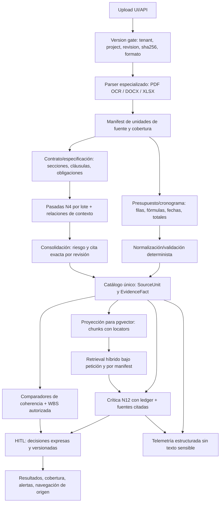

# C2Pro — CORE multidocumental | Plan de ejecución P1–P3

**Versión:** 2.0 (diseño técnico ampliado; §9–§18) · **Fecha:** 2026-11-04 · **Estado:** PLAN APROBADO PARA DOCUMENTACIÓN / IMPLEMENTACIÓN P1–P3 AÚN NO AUTORIZADA COMO DESPLIEGUE
**Repositorio:** AI-Gen-AI/C2Pro · **Candidato de integración:** [PR #1112](https://github.com/AI-Gen-AI/C2Pro/pull/1112) · **Base inspeccionada:** `34f1f67d66f26c2e905570c39a0d693c605fca6e`.
**Propósito:** una hoja de ruta ejecutable y actualizable, sin crear WORK redundantes ni rehacer auditorías. Este plan no acredita funcionalidad ni sustituye la UAT real.

## 0. Resumen ejecutivo y arquitectura

**Decisión:** arquitectura **B**: capa común de cobertura, integridad y procedencia **por revisión inmutable**, más extractores especializados por familia documental. RAG existente y LLM se reutilizan selectivamente para interpretación; **no** son autoridad de cobertura ni de aprobación humana. La arquitectura C (recuperación contextual adicional) solo se habilitará si un experimento diferencial acredita beneficio concreto.

Cuatro entradas: **Contrato** (obligaciones/riesgos); **Presupuesto** (filas, cantidades, divisas y totales); **Cronograma** (actividades, fechas, dependencias observadas); **Especificación técnica** (requisitos y parámetros). Salida: evidencia revisable vinculada a fuente + interpretación y contradicciones **confirmadas, provisionales o NOT_ASSESSED**, sin puntuación fabricada.

**Invariantes no negociables:**
- Tenant, proyecto, documento, `revision_id`, huella/hash y localizador de fuente acompañan cada dato usado para una decisión. La última carga/propuesta nunca sustituye implícitamente una revisión trusted-current.
- `DocumentStatus.ANALYZED` **no** es sinónimo de cobertura, comprensión semántica ni aprobación: mantener indicador independiente por revisión (`COMPLETE | PARTIAL | UNSUPPORTED | UNVERIFIED`, con motivos, contadores y unidades).
- No convertir citas verbatim en garantía de interpretación; no tratar «procesado el 100 % del texto» como «100 % de recall». Toda unidad de fuente debe estar contabilizada, incluida la excluida/incompatible.
- Una fila Excel o código WBS impreso **no** es una WBS canónica; los enlaces y decisiones siguen las autorizaciones humanas existentes. TECHNICAL solo puede puntuarse con evidencia y autoridad de cumplimiento reales.
- Sin datos ficticios como hechos de cliente; sin volcado de prompts, contratos o respuestas del modelo a LangSmith/logs no autorizados; no filtrar información entre tenants.
- Limitar los cambios a flujos actuales; no añadir otro RAG, nuevos LLM, Neo4j, gestor genérico de agentes, ruta crítica, calendarios o parsers MPP/XER en esta entrega.

## 1. Estado de partida / puerta de entrada P0

| Elemento | Estado a 2026-11-04 | Puerta de entrada |
|---|---|---|
| PR #1112 | OPEN / DRAFT, sin merge; HEAD base `34f1f67d` verificado para este plan | Claude mantiene **escritura exclusiva** de esa rama. |
| P0 Codex | **Reportado** local en `codex/core-p0-20261104`, commit `232ef48375eb6672b2df6ea76bcaa49b7c3d6fe6`; 16 pruebas focalizadas PASS reportadas | El commit **no se pudo recuperar en GitHub durante la redacción**; no asumir publicado ni integrado. Verificar push/HEAD remoto, revisión diferencial, integrarlo en #1112 sin sobreescrituras, y entonces fijar nuevo SHA. |
| P0 técnico | Fallback BC3 sintético, cobertura declarativa y trazas/logs sensibles según reporte de Codex | Acreditar que el código realmente elimina el mock BC3, expone cobertura veraz y no exporta payload sensible; no repetir auditoría general. |
| P1, P2, P3 | Planificados, **NO IMPLEMENTADOS / NO ACEPTADOS** | Cada fase requiere evidencia de los criterios de salida específicos. |

**Gate G0:** validar que P0 publicado e integrado en candidato de trabajo, sin perder cambios de Claude, y fijar un HEAD exacto. Si P0 sigue solo local, ejecutar P1 en base controlada pero **no declarar P0 integrado**. No modificar main ni desplegar producción.

## 2. Contrato técnico común: ledger de cobertura y evidencia

Para cada revisión inmutable, registrar al menos: `tenant_id`, `project_id`, `document_id`, `revision_id`, `blob_sha256`, familia, formato, algoritmo/versión de extracción, instante, estado, motivo, totales por tipo y unidades de origen. Cada unidad (`clause/section/span` o `sheet!row`) posee identidad y localizador, estado `EXTRACTED | SKIPPED | UNSUPPORTED | UNVERIFIED`, motivo, enlace a evidencia y, cuando corresponda, offset/página/columna. Evitar guardar texto contractual completo en telemetría.

**Cobertura documental:** `COMPLETE` solo si todas las unidades esperadas de la fuente aceptada están inventariadas/procesadas sin desconocidos; `PARTIAL` ante exclusiones/acortamientos; `UNSUPPORTED` para formato sin extractor válido; `UNVERIFIED` cuando no puede acreditarse integridad o resultado. **Cobertura semántica/interpretativa es un indicador separado:** un documento puede estar totalmente indexado y todavía no evaluado en riesgos, TIME o TECHNICAL.

Persistir con contratos y metadatos de revisión existentes, sin introducir una migración global si no resulta imprescindible; no almacenar estados nuevos en `DocumentStatus` por defecto. Los consumidores downstream deben usar **una sola revisión trusted-current** o declarar `NOT_ASSESSED`.

## 3. P1 — Extracción completa y evidencias de cuatro familias

**Dependencia:** G0, contrato de ledger estable. **Propietario propuesto:** Codex (escritor de su rama); Claude (integrador y guardián de #1112); ChatGPT (revisión de salidas y coordinación). Los bloques se integran **secuencialmente** y se prueban en aislamiento, sin dos escritores simultáneos en archivos comunes.

### P1-A — Presupuesto XLSX: libro de filas y totales

**Modificar/reutilizar:** 
- `apps/api/src/documents/adapters/parsers/excel_file_parser.py`
- `apps/api/src/analysis/application/extract_budget_revision_evidence_use_case.py`
- `apps/api/src/analysis/domain/budget_row_evidence.py`
- `apps/api/src/documents/application/budget_stated_total.py`
- `apps/api/src/core/tasks/ingestion_tasks.py`
- `apps/api/src/documents/application/parse_document_use_case.py`

**Implementación:**
1. Inventariar **todas las hojas** del XLSX; procesar las compatibles según política explícita y registrar hojas/filas sin procesar. Nunca confundir la hoja activa con todo el libro.
2. Conservar identidad de fila (`Hoja!fila`), tipo (partida, capítulo/subtotal, total declarado, vacío, inválido), cantidad, unidad, precio, importe, divisa y base fiscal cuando sean legibles. Evitar doble cómputo de capítulos.
3. Fórmulas: preservar expresión y estado de cálculo si es visible; el caché no acredita recalculado. Valores sin verificación **no producen hechos confirmados**. Un error en una fila no debe borrar silenciosamente el resto.
4. Enlazar `ExtractBudgetRevisionEvidenceUseCase` existente, que verifica bytes/revisión y previene filas duplicadas; no inventar WBS. Conservación por revisión y contabilización idempotente.
5. Conciliar total declarado, suma de partidas y subtotales con precisión adecuada (`Decimal`); ambigüedad sobre varias filas «TOTAL», impuestos, divisas o fórmulas = `NOT_ASSESSED` con motivo.

**Salida verificable:** inventario de hojas, `N` filas fuente, `N` evaluadas/`N` excluidas con causa, totales y sus localizadores exactos. Al menos una conciliación de partida↔total que no dependa de un mock/BOM ajeno. **No** implementar BC3 real salvo proyecto separado; P0 debe fallar cerrado.

**Pruebas dirigidas:** 2 hojas, subtotal etiquetado TOTAL, fórmula sin caché acreditado, varias divisas, partida duplicada, reupload y replay idempotente, tenant B negado.

### P1-B — Cronograma XLSX: actividad por fila y observación temporal

**Modificar/reutilizar:**
- `apps/api/src/documents/adapters/parsers/excel_file_parser.py`
- `apps/api/src/analysis/application/extract_schedule_revision_evidence_use_case.py`
- `apps/api/src/analysis/domain/schedule_activity_evidence.py`
- `apps/api/src/documents/application/schedule_planned_finish.py`
- `apps/api/src/coherence/schedule_clause_builder.py`
- `apps/api/src/core/tasks/ingestion_tasks.py`

**Implementación:**
1. Inventariar todas las hojas y actividades; guardar identidad `sheet!row`, nombre, ID de actividad/hito cuando exista, fechas literales, duración, WBS fuente y texto de predecesoras. Distinguir fechas observadas de calendario calculado.
2. Resolver duplicados e IDs ambiguos conservadoramente; fórmulas/fechas no acreditadas se etiquetan sin usarlas como baseline confirmada.
3. Conectar el caso de uso existente `ExtractScheduleRevisionEvidenceUseCase`; no interpretar texto WBS como enlace autorizado. Baseline aprobada es acto separado.
4. Conservar la última fecha fin **observada y sustentada** por revisión, con cobertura de actividades y limitaciones; múltiples cronogramas no se combinan por heurística.
5. Comparar con fecha contractual usando regla existente: **PROVISIONAL** cuando el fin es mera observación, **CONFIRMED** únicamente ante baseline válida y autoridad verificada.

**Salida verificable:** actividades inventariadas por revisión y hoja, contadores de fechas observadas/no evaluables, origen de cada fecha y razón explícita de no comparación. **Fuera de alcance:** CPM/ruta crítica, holguras, calendarios múltiples, replanificación predictiva y MPP/XER.

**Pruebas dirigidas:** 2 hojas, actividad con fórmula, predecesora textual, IDs duplicados, plazo posterior a contrato, baseline no aprobada, revisión propuesta, tenant B negado.

### P1-C — Contratos y especificaciones técnicas: cobertura de narrativa

**Modificar/reutilizar:**
- `apps/api/src/core/tasks/ingestion_tasks.py`
- `apps/api/src/documents/application/technical_requirement_clauses.py`
- `apps/api/src/analysis/domain/risk_provenance.py`
- `apps/api/src/analysis/domain/citation_validation.py`
- `apps/api/src/analysis/adapters/graph/nodes.py`

**Implementación:**
1. Conservar los rangos completos aunque una cláusula o sección supere 4.000 caracteres; fragmentar en **subspans unidos al mismo identificador fuente** si es necesario. Segmentos cortos/no clasificables se contabilizan, no desaparecen.
2. Para especificaciones reconocer encabezados estructurales reales (`4.2 Transformadores`, `Section 5`, etc.) y registrar **cada obligación**, no solo la primera por sección. Extracción de números/unidades/tolerancias como valores de fuente **unverified**, nunca como cumplimiento.
3. Tablas, anexos, OCR y texto no reconocible: inventariar limitación; no afirmar completa cobertura.
4. Alinear N4 y N15 en la identidad original/anonimizada de la cita y su verificación literal; `source_quote` debe estar vinculado a la misma revisión, no a texto libre de otra.
5. No alterar autoridad humana: una especificación indexada y un enlace WBS aprobado para revisión **no** acreditan conformidad técnica.

**Salida verificable:** toda sección/span contabilizada, obligaciones con offsets y revisión; ninguna cita atribuida a una revisión equivocada. Tests: encabezados numéricos, 2 obligaciones por sección, cláusula >4.000 caracteres, anexo al final y cita atravesando salto de línea.

### Gate P1 — aceptación

- En el proyecto sintético de referencia, **100 % de unidades fuente contabilizadas** como procesadas, excluidas con motivo o incompatibles; sin exclusiones conocidas invisibles. Esto **no** afirma recall semántico del 100 %.
- Cuatro familias con identidad `tenant/document/revision/hash` y evidencia localizada; reupload/replay no mezcla revisiones.
- Las rutas de ingestión actuales no empeoran el Complete Journey; formatos no soportados no presentan un análisis completo.
- Entrega 1 commit coherente por subfase, pruebas focalizadas, nota de riesgos y HEAD para integración. Solo Claude integra #1112.

## 4. P2 — Inteligencia y coherencia multidocumental

**Dependencia:** P1 aceptado en candidato; entrada única versionada por familia. No rediseñar las API existentes si hay un adaptador válido.

### P2-A — N4/N12: extracción y crítica con cobertura y evidencia

**Archivos clave:** `analysis/adapters/ai/tools/risk_extraction_tool.py`, `analysis/adapters/graph/nodes.py`, `analysis/domain/ai_extraction.py`, `analysis/application/critique_extraction_use_case.py`, `analysis/domain/critique_evaluation.py`, `analysis/domain/risk_provenance.py`.

- N4 consume cláusulas/subspans **por revisión**, en lotes completos con contexto de definiciones y referencias cuando sea necesario. El filtro léxico y los 40.000 caracteres pueden servir para priorizar, **no excluir** unidades sin declarar cobertura parcial.
- No truncar silenciosamente a 20 riesgos a nivel documento: límites por lote + consolidación trazable; deduplicar por evidencia y significado, preservar relaciones contradictorias y candidatos descartados con motivo.
- N12 valida riesgos contra las **cláusulas citadas y el ledger**, distingue consistencia de exhaustividad y marca omisiones/no evaluables. El fragmento actual de 16.000 caracteres no es prueba de ausencia documental.
- `confidence=None` permanece honesto cuando no existe medición, y el HITL mantiene su gate. Nunca interpretar un prompt «3–8» como número máximo de riesgos de un contrato grande.
- No enviar texto de clientes a trazas de evaluación. Experimento sintético sin datos reales.

**Aceptación:** riesgo con fuente completa, revisión y localizador; cobertura parcial visible al humano; riesgos de cláusulas situadas al principio/mitad/final alcanzan la evaluación; se preserva el manejo de fallos y `None`.

### P2-B — Coherencia determinista y WBS con autoridad

**Archivos clave:** `coherence/cross_document/inputs.py`, `coherence/cross_document/assembly.py`, `coherence/cross_document/comparators.py`, `coherence/budget_clause_builder.py`, `coherence/schedule_clause_builder.py`, `analysis/application/canonical_structured_wbs_links.py`, `analysis/application/record_technical_wbs_review.py`, `coherence/graph/nodes.py`.

- Conectar filas de presupuesto y actividades **trusted-current** a comparadores existentes; habilitar `DET-BUD-INTERNAL` y sumas por WBS solo con alcance y aprobaciones probados.
- Diferenciar: `CONBUD/NEGMARGIN` con importes, divisas, bases fiscales comparables; `SCHDEAD` provisional si el cronograma no tiene baseline aprobada; `NOT_ASSESSED` si falta verificación. No usar valores cacheados de fórmulas como importes aprobados.
- Requisitos técnicos/FAT sin enlace WBS: presentar como **«sin enlace demostrado»**, no «incumplimiento de especificación». Un requisito del contrato no convierte automáticamente un artefacto en canon.
- Revisiones propuestas, decisiones humanas pendientes y líneas de otro tenant nunca contaminan el estado trusted; recomputar tras cambio de revisión, sin duplicar alertas ni borrar decisiones.
- Contradicciones complejas especificación↔partida sin correspondencia estructurada: `NOT_ASSESSED` explícito antes que inventar matching semántico.

**Aceptación:** hallazgos con ambas fuentes, mismas revisiones/autorizaciones y tipo de certeza; sin promoción de `PROPOSED` a `TRUSTED`; idempotencia de alertas y enlace verificable en interfaz.

### Gate P2 — aceptación

- Los comparadores operativos están **conectados**, no solo presentes en código. Cada regla publica estado: `CONFIRMED | PROVISIONAL | NOT_ASSESSED`, con motivo cuando no se evalúa.
- Cobertura faltante bloquea declaraciones de coherencia completa y puntuaciones injustificadas; Score sigue `NULL` para TECHNICAL sin cumplimiento acreditado.
- N4/N12 identifican los riesgos sintéticos etiquetados dentro del alcance y muestran explícitamente qué relaciones no pueden evaluar.
- Validación específica de revisiones, A/B tenants, deduplicación, permisos y contradicciones conocidas; no suite general repetida sin motivo.

## 5. P3 — Un único Complete Journey real y UX de cliente

**Dependencia:** P1 + P2 integrados en candidato, despliegue aislado y controlado. El objetivo P3 es **producto visible**, no tests de código como sustituto de experiencia.

### P3-A — Proyecto sintético y verdades de referencia

Un solo proyecto persistido con **cuatro documentos**, datos inventados pero coherentes en identidad:
1. **Contrato DOCX/PDF:** precio 10 M EUR, entrega 30-06-2027, cláusula FAT, obligación sin keywords obvias y anexo/requisito al final; una sección >4.000 caracteres.
2. **Presupuesto XLSX:** pestañas Resumen + Partidas; importe conocido >10 M EUR para activar posible margen negativo cuando exista base verificada; falso subtotal rotulado TOTAL; fórmula sin resultado acreditado; partida deliberadamente ausente.
3. **Cronograma XLSX:** termina 30-09-2027, actividad con fórmula, dependencias fuente, un hito sin enlace aprobado; distinguir fin observado frente a baseline.
4. **Especificación DOCX:** «4.2 Transformadores — 50 MVA ±5 %» sin «Section» y otra sección FAT; revisión v2 propuesta cambia parámetro, no se incorpora como trusted hasta aprobación.

Publicar un **oráculo de evaluación** (tabla de hechos que se sabe que existen, su ubicación y respuesta esperada): confirmado, provisional, no evaluable con motivo; al menos una contradicción contractual/económica, una temporal y una ausencia de mapeo técnico explícita. No fijar arbitrariamente que *todas* las contradicciones deban ser detectadas si la capacidad no está implantada: la diferencia debe declararse como brecha.

### P3-B — Una prueba integral observable, sobre URL real aislada

Misma revisión de frontend/backend, servicio API, worker y base PostgreSQL. Una pasada E2E con:
- Clerk real A: login, crear proyecto y subir los cuatro documentos vía UI; UUID, revisión, hash y cobertura consultables.
- Ejecutar evaluación con **IA real** para N4/N12 donde corresponda; no confundir mock determinista con aceptación. Observar resultados, errores y costes.
- Abrir riesgos, alertas y comparadores; navegar a fuente y localizador originales. Estado `PARTIAL/NOT_ASSESSED` y motivos visibles.
- Realizar HITL donde sea exigible; probar decisión persistida; ninguna promoción automática.
- Salir y entrar de nuevo: persisten proyecto, documentos, decisiones y avisos. Identidad B de otro tenant no puede ver ni modificar recursos de A.
- Verificar una entrada no soportada (ej. BC3 sin parser) con error claro y **sin** datos sintéticos.
- Capturar evidencias mínimas: URL/snapshot, SHA de frontend/backend, pasos principales de navegador, IDs y respuestas/filas PostgreSQL *sin secretos*, coste/latencia, divergencias y primera causa de fallo.

**No programar rondas indefinidas.** Una prueba integral y correcciones focalizadas si falla; repetir únicamente el tramo afectado y, tras integración, una aceptación integral final. Los tests unitarios dirigidos son condición de calidad, no sustituyen esta prueba.

### Gate P3 — aceptación de usuario piloto

- Carga real de cuatro documentos e identidad persistida por revisión; resultados estables tras relogin.
- Se visualizan hechos/alertas correctos o una limitación explícita; **cero hallazgos confirmados sin fuentes verificables**, cero datos BC3 inventados, cero filtraciones entre tenants.
- Se prueba al menos una comparación económica y una temporal con semántica correcta; dimensión TECHNICAL no se inventa.
- Experiencia utilizable sin navegación engañosa: el usuario entiende «qué se revisó», «qué riesgo importa», «por qué» y «qué no se sabe».
- Se publica dictamen `ACCEPTED | PARTIAL | NOT_ACCEPTED` con primera brecha, no una etiqueta de éxito basada en CI verde. Si S1–S8 completo requiere funciones adicionales, **no** declararlo 8/8 por esta prueba CORE.

## 6. Ejecución, secuencia, dependencias y no duplicación

| Orden | Paquete | Responsable de escritura | Dependencia | Esfuerzo relativo | Evidencia de cierre |
|---|---|---|---|---|---|
| G0 | Verificar/absorber P0 `232ef483` | Claude integra; Codex prepara | Remoto disponible | Bajo–medio | SHA exacto #1112 y pruebas mínimas |
| P1-A | Libro de presupuesto | Codex, rama propia | G0/ledger | Medio–alto | Evidencia por fila + cobertura + reconciliación |
| P1-B | Libro de cronograma | Codex, rama propia | G0/ledger | Medio | Actividades + estados fecha + origen |
| P1-C | Contratos y especificaciones | Codex, rama propia | G0/ledger | Alto | Rango íntegro + obligaciones + localizadores |
| P2-A | N4/N12 por cobertura y lotes | Codex, rama propia | P1-C | Alto | Extracción/crítica sin corte silencioso |
| P2-B | Comparadores/WBS | Codex, rama propia | P1-A/B/C | Medio–alto | Regla conectada, estado y fuentes |
| P3-A/B | Dataset, UI, una E2E UAT | Claude integra/ejecuta; Codex corrige exclusivamente bloqueos asignados | P1/P2 | Medio–alto | Informe user journey con evidencias exact-SHA |

**Política de coordinación:** un solo escritor por rama y archivo; Codex en worktree + rama independiente, commits pequeños por paquete; Claude decide cherry-pick/rebase y conserva #1112 OPEN/DRAFT; no push/PR/despliegue/merge a producción por defecto. Revisar diferencias contra HEAD remoto antes de integrar. Mantener el mismo enlace de este plan y registrar en el checkpoint de #1112 los SHAs, PASS/FAIL, bloqueos y siguiente paquete. No multiplicar issues, planes o PR sin necesidad.

**Estado actualizado del plan (editar este documento, no duplicarlo):**
- G0 — P0 remoto/integración: **PENDING**
- P1-A / P1-B / P1-C: **PLANNED**
- P2-A / P2-B: **PLANNED**
- P3-A / P3-B: **PLANNED**

## 7. Riesgos y condiciones STOP

1. P0 no disponible en remoto o conflictos con Claude → detener integración, conservar commits y resolver solo diffs afectados.
2. Migración irreversible o cambio de contrato canónico `RiskItem/WBS` → exigir decisión técnica específica antes de escribir.
3. Excel fórmulas sin cálculo probado → no promover cantidades/fechas a verificadas; `PARTIAL/NOT_ASSESSED`.
4. Falta de revisión/hash/tenant o propuesta pendiente → no consumir en scoring/alerta confirmada.
5. Se requiere nuevo modelo, OCR masivo, parser BC3 o rutas críticas → fuera de alcance P1–P3; registrar propuesta posterior.
6. Sin infraestructura aislada apta para UAT (Clerk A/B, frontend/backend/PG coherentes) → P3 `BLOCKED`, no sustituir por tests mock.
7. Cualquier traza/log con texto real → STOP de evaluación con datos sensibles hasta contenida; trabajar solo con corpus sintético.

## 8. Referencias de implementación en el repositorio

- [PR #1112 — candidato integrado](https://github.com/AI-Gen-AI/C2Pro/pull/1112).
- [ACC-01 #1049 — recorrido del usuario](https://github.com/AI-Gen-AI/C2Pro/issues/1049).
- [MASTER PQ-HITL #936 — revisión granular y autoridad](https://github.com/AI-Gen-AI/C2Pro/issues/936).
- [N4 `risk_extraction_tool.py`](https://github.com/AI-Gen-AI/C2Pro/blob/34f1f67d66f26c2e905570c39a0d693c605fca6e/apps/api/src/analysis/adapters/ai/tools/risk_extraction_tool.py).
- [N12 `ai_extraction.py`](https://github.com/AI-Gen-AI/C2Pro/blob/34f1f67d66f26c2e905570c39a0d693c605fca6e/apps/api/src/analysis/domain/ai_extraction.py).
- [Ingesta `ingestion_tasks.py`](https://github.com/AI-Gen-AI/C2Pro/blob/34f1f67d66f26c2e905570c39a0d693c605fca6e/apps/api/src/core/tasks/ingestion_tasks.py).
- [Excel `excel_file_parser.py`](https://github.com/AI-Gen-AI/C2Pro/blob/34f1f67d66f26c2e905570c39a0d693c605fca6e/apps/api/src/documents/adapters/parsers/excel_file_parser.py).
- [Requisitos técnicos](https://github.com/AI-Gen-AI/C2Pro/blob/34f1f67d66f26c2e905570c39a0d693c605fca6e/apps/api/src/documents/application/technical_requirement_clauses.py).
- [Presupuesto: evidence use case](https://github.com/AI-Gen-AI/C2Pro/blob/34f1f67d66f26c2e905570c39a0d693c605fca6e/apps/api/src/analysis/application/extract_budget_revision_evidence_use_case.py).
- [Cronograma: evidence use case](https://github.com/AI-Gen-AI/C2Pro/blob/34f1f67d66f26c2e905570c39a0d693c605fca6e/apps/api/src/analysis/application/extract_schedule_revision_evidence_use_case.py).
- [Comparadores](https://github.com/AI-Gen-AI/C2Pro/blob/34f1f67d66f26c2e905570c39a0d693c605fca6e/apps/api/src/coherence/cross_document/comparators.py).

**Regla para futuras sesiones:** comenzar leyendo *esta versión del plan*, revalidar PR HEAD y estado del gate inmediatamente anterior; responder con `fase | SHA | cambios | pruebas | bloqueo | siguiente paso`. El plan es guía; ninguna declaración de PASS sin evidencia del HEAD integrado.


---

# PARTE II — Diseño técnico implementable del CORE (versión 2.0, 2026-11-04)

> **Esta parte es normativa para el diseño P1–P3 y corrige una omisión de v1.** La parte I contiene la secuencia de entregas; esta parte define cómo funciona el motor, sus conexiones reales, contratos de datos, límites, observabilidad y pruebas de escala. **No confundir código presente con integración efectiva, ni el límite de subida con capacidad semántica.** Evidencias fijadas al commit base `34f1f67d66f26c2e905570c39a0d693c605fca6e`; revalidar contra HEAD de la rama de integración y contra P0 antes de escribir.

## 9. Inventario REAL de las piezas LangGraph / LangChain / RAG / LangSmith

| Componente | Hecho verificado en código | Estado para CORE completo | Referencia |
|---|---|---|---|
| **LangGraph** | `StateGraph(ProjectState)`, N1–N17, `interrupt()`, `AsyncPostgresSaver`, rutas condicionales y ramas paralelas | **Implementado** como orquestación; su ruta N4/N12 no contiene recorrido exhaustivo por unidad documental | `analysis/adapters/graph/workflow.py`, `nodes.py`, `schema.py` |
| **LangChain** | `langchain_core.messages`, `RunnableConfig` y agentes `ChatAnthropic` en módulos de procurement | **Usado**, pero no existe una cadena LangChain universal que conecte extracción contractual con vector search; N4 utiliza el wrapper/tool propios | `analysis/adapters/graph/workflow.py`; `core/ai/anthropic_wrapper.py`; `procurement/application/bom_builder_service.py` |
| **RAG vectorial de documentos** | Tabla `document_chunks` con `pgvector.Vector(1536)`, embeddings OpenAI `text-embedding-3-small` (1.536 dim), inserción PG y operador coseno `<=>` | **Implementado en código**. El runtime de PostgreSQL, credenciales, dimensión e índices efectivos **no han sido acreditados para un contrato grande en esta revisión** | `documents/adapters/rag/rag_service.py`, `documents/adapters/persistence/models.py` |
| **Índice ANN** | Alembic prevé índice HNSW (`vector_cosine_ops`) para `document_chunks` y `clause_embeddings` | **Migración escrita, estado físico real NO VERIFICADO**. El ORM por sí solo no prueba índice instalado | `alembic/versions/20260315_0001_add_document_chunks_rag.py`; `20260401_0001_add_clause_embeddings.py` |
| **Ingesta RAG** | `SqlAlchemyRagIngestionService` convierte texto/clauses/filas del cronograma a chunks, ejecuta embedding y guarda metadatos de `revision_id` | **Conectado a la ingestión**; falta garantizar cobertura e identidad de subspan/tabla; la rama mock produce embeddings deterministas solo para pruebas | `documents/adapters/rag/sqlalchemy_rag_ingestion_service.py`, `core/tasks/ingestion_tasks.py` |
| **Consulta vectorial real** | `RagService.answer_question` embebe pregunta, ejecuta SQL `ORDER BY embedding <=> query_vector LIMIT top_k` y construye respuesta con Anthropic | **Implementado para Q&A**, con `top_k=5`; no demuestra recall ni prueba que el CORE N4/N12 consulte el índice | `documents/adapters/rag/rag_service.py:147–220,375–420` |
| **Coherencia (get_clauses_from_rag)** | Prioriza filas `clauses` mediante SQL por keywords + relleno cronológico; fallback a `document_chunks` por fecha | **No es una búsqueda vectorial coseno en esa ruta**. `max_chunks=50` por defecto impide confundir la muestra con cobertura de todas las cláusulas | `coherence/router.py:368–590` |
| **WBS Reviewer** | Lectura explícita de `document_chunks` por manifest `tenant/project/document/revision` (sin similitud vectorial) | **Rutas acotadas y gobernadas**, útiles como patrón de autoridad; no cubre por sí sola N4/N12 ni un contrato entero | `wbs/intelligence/reviewer/evidence.py` |
| **N4** | Texto `state["document_text"]`, filtrado keywords ES/EN, techo 40.000 caracteres por defecto y hasta 20 riesgos | **No conectado al retrieval vectorial ni al ledger exhaustivo** | `analysis/adapters/ai/tools/risk_extraction_tool.py` |
| **N12** | `source_text` (preferentemente anonimizado), primer excerpt de hasta 16.000 caracteres, salida OK/RETRY | **No es auditor de cobertura del documento completo**, aunque advierte que el excerpt es parcial | `analysis/domain/ai_extraction.py`; `analysis/adapters/graph/nodes.py` |
| **LangSmith** | Cliente custom + decorador. Opt-in custom false sin bandera; tracing nativo puede activarse por env | **Instrumentación parcial y no probada de extremo a extremo**. `.env.example` y CI del HEAD base habilitan trazas; P0 Codex reporta corrección todavía no verificada remotamente | `core/ai/langsmith_client.py`, `core/observability/langsmith_decorator.py`, `.env.example`, `evaluation-regression.yml` |

**Conclusión técnica:** la recuperación vectorial es **real como código de búsqueda**; la integración vectorial **con la extracción exhaustiva, crítica y coherencia de las cuatro familias no está demostrada**. No contratar ni añadir un vector DB distinto antes de medir la capacidad de pgvector existente.

## 10. Arquitectura objetivo: rutas distintas, un catálogo común de evidencia



**Normas:** (1) Enumeración exhaustiva de origen y ledger **antes** de RAG. (2) RAG localiza contexto de relación, nunca decide que un span no existe. (3) La IA propone significado, no fija autoridad, totales, fechas o conformidad por sí sola. (4) Solo evidencia `trusted-current` participa en resultados canónicos; `proposed` queda etiquetada y acotada. (5) La experiencia debe distinguir *indexado*, *interpretado*, *comparado*, *aprobado*.

### 10.1 Puertos y modelos de dominio (contratos propuestos; **NO** implementados)

Crear un **manifiesto por revisión** reutilizando P0 `documents/application/document_coverage.py` **solo después de recuperar y revisar el commit P0**, evitando dos implementaciones. Un ejemplo de contrato mínimo:

```python
class SourceUnit(TypedDict):
    tenant_id: str
    project_id: str
    document_id: str
    revision_id: str
    blob_sha256: str
    family: str  # contract|budget|schedule|technical_spec
    unit_id: str  # determinista dentro de revisión
    source_locator: dict  # sheet, row, cells O section, page, offsets
    span_sha256: str | None
    status: str  # EXTRACTED|SKIPPED|UNSUPPORTED|UNVERIFIED
    reason_code: str | None
    parent_unit_id: str | None  # section/subspan/row
class CoverageManifest(TypedDict):
    revision_id: str
    parser_version: str
    enumerated_count: int
    extracted_count: int
    skipped_count: int
    unsupported_count: int
    unverified_count: int
    coverage_status: str  # COMPLETE|PARTIAL|UNSUPPORTED|UNVERIFIED
    units: list[SourceUnit]
class EvidenceFact(TypedDict):
    source_unit_id: str
    source_revision_id: str
    fact_kind: str  # obligation|risk|quantity|price|date|technical_parameter...
    normalized_value: dict
    evidence_quote_status: str
    semantic_assessment: str  # ASSESSED|UNASSESSED|REVIEW_REQUIRED
    authority: str  # observed|provisional|trusted|human_approved
```

**Implementación física:** decidir tras leer P0 si se guardan índices y estados compactos en metadata por revisión y detalles en artefactos versionados; para miles de filas, **no** introducir un JSON sin límite en `document_metadata`. Evitar blobs contractuales en mensajes LangGraph o LangSmith: `ProjectState` debe transportar identificadores y referencias de artefactos, no un contrato completo copiado en cada checkpoint de N4/N12. Si el esquema actual obliga a mantener `document_text` como compatibilidad, acotar esa transición y documentar la duplicación.

### 10.2 Interfaz de recuperación para el CORE

Proponer puerto `EvidenceRetriever.retrieve(scope, unit_ids, relation_hints, budget)`, donde `scope` fija tenant, proyecto y lista exacta de (document, revisión, sha256) admitidos. Respuesta ordenada: `source_unit_id`, `revision_id`, `locator`, `content`, `retrieval_method`, `confidence/score`, `reason`.

**Orden obligatorio:**
1. Consulta determinista de cláusula/fila **por ID y revisión**, cuando ya se conoce la fuente.
2. Expansión estructural: definiciones, anexos y referencias explícitas; incluir texto vecino o versión exacta.
3. Recuperación híbrida lexical/vectorial para **descubrir relaciones** no conocidas, con pgvector existente y filtro SQL por tenant/proyecto/revisión, nunca búsqueda entre tenants.
4. Re-ranking/verificación de atribución por `source_unit_id`; si no hay fuente verificable → `NOT_ASSESSED`.
5. Límite de resultados que no convierta silencio en ausencia: registrar `retrieval_exhausted`, `top_k`, documentos/revisiones buscados y número de candidatos descartados.

**No reutilizar sin adaptación** `RagService.answer_question` como extractor completo: su `top_k=5`, chunks normalizados por whitespace y metadatos generales (`document_type/revision_id`) no garantizan localizador de página/cláusula/fila. Puede conservarse para Q&A. El lector del WBS Reviewer ofrece un patrón seguro de *manifest-scoped retrieval* que conviene reaprovechar.

## 11. Tamaños documentales: límites REALES y cómo eliminamos pérdidas de contenido

### 11.1 Límites hallados en el código base

| Capa | Límite/configuración observada | Qué garantiza / qué NO |
|---|---|---|
| Upload | `apps/api/src/config.py:321`: `max_upload_size_mb=50` por defecto, rango configurable 1–200; router recibe en bloques de 8 MiB | Protege la recepción; **no** establece máximo de páginas, celdas, tokens o tiempo de OCR. Revalidar proxy/load balancer/deployment antes de afirmar 50 MB efectivos. |
| PDF | PyMuPDF página a página, OCR Tesseract opcional si no hay texto o la capa es ilegible; idioma ES+EN configurado | No garantiza OCR fiable de tablas, gráficos, sello, planos o PDFs escaneados; falta presupuesto explícito de páginas/tiempo/memoria y métrica de calidad |
| DOCX | Extracción de bloques; revisar tablas, numeración, notas, anexos y orden de fuente | Documento parseado puede no equivaler a todos los elementos interpretados |
| Excel | `workbook.active` en los parsers base; el modo evidencia inspecciona fórmulas con segundo libro `data_only=False` | Actualmente pueden omitirse hojas y no verificarse fórmulas; tamaño en MB no predice número de filas |
| Cláusulas persistidas | `ingestion_tasks.py:815`: `segment[:4000]`; técnico `_MAX_SOURCE_CHARS=4000` | Se pierde parte de cláusulas/secciones largas si no se conserva origen/subspans |
| RAG vector | `_split_text`: chunks de 1.000 caracteres con 200 de solape, whitespace normalizado; `DEFAULT_TOP_K=5` | Es índice de búsqueda, no cobertura ni citación estructural |
| N4 | 40.000 caracteres por defecto (variable `RISK_EXTRACTION_MAX_CHARS`, 5.000–200.000) y `max_risks=20` | Una llamada puede ver solo parte del contrato y descartar hallazgos |
| N12 | `_CRITIQUE_MAX_SOURCE_CHARS=16000`; prefijo del texto | No puede certificar omisiones fuera de esa ventana |
| LLM | `model_router.py` fija `max_tokens` de **salida** (p. ej. 8.192 para configuración Standard) | No confundir máximo de salida, ventana de contexto del proveedor, coste y capacidad de comprender un documento entero |

**Veredicto sobre tamaño:** el límite público **comprobado en código** es de upload, no de páginas analizadas; **no existe todavía una garantía demostrada de «300 páginas analizadas sin omisiones»**. La solución no es simplemente aumentar contexto del LLM.

### 11.2 Diseño requerido para documentos grandes

- **Parse incremental y paginado**, con protección de memoria, timeout, páginas/celdas máximas por tarea y capacidad de reanudación **por revisión y generación**, sin cambiar el documento original; procesar OCR solo donde haga falta y registrar `OCR_LOW_CONFIDENCE`.
- **Manifest-first:** enumerar páginas/bloques/secciones/hojas/filas, reconciliar offsets de origen y número de unidades antes de ejecutar IA o embeddings. Para una sección >4.000 caracteres, fraccionar **sin descartar** y vincular subspans al mismo padre.
- **Cola de lotes idempotentes:** `(tenant,project,revision,parser_version,unit_id,model/prompt_version)` como clave funcional; reintentos solo del lote fallido, semáforo de concurrencia, checkpoint por lote, costes y status. No almacenar el texto completo en checkpoints del grafo.
- **Ventana de análisis:** `budget = modelo_contexto_real - instrucciones - unidades - referencias - output_reserve`. El conteo debe basarse en tokens del proveedor/modelo seleccionado, no en `chars/4` como única protección. Overflow → subdivisión, jamás truncado silencioso.
- **Consolidación global:** procesar todas las unidades inventariadas, validar citas, eliminar duplicados sin borrar hechos distintos, formar relaciones entre unidades y detectar contradicciones de anexo/prelación.
- **Circuit breaker y degradación:** fallo OCR, embeddings, LLM, fórmula o base de datos → estado `PARTIAL/UNVERIFIED` con motivo y opción de continuar, no «éxito» ni bucle infinito.
- **Modelo de costes:** almacenar entradas/salidas por lote, cache hits, embedding tokens, latency, retries, coste estimado y real; límites por proyecto/ejecución configurables. Superación del presupuesto → pausa con aceptación del usuario y cobertura parcial honesta.

### 11.3 Matriz de capacidad y gates de escala (OBJETIVOS, no resultados)

| Perfil sintético | Qué se prueba | Condición de aceptación |
|---|---|---|
| Contrato de 10 páginas | Integración básica | 100 % bloques fuente inventariados; hechos conocidos encontrados o causa visible |
| Contrato de 50 páginas | Contexto distribuido | Anexos y definiciones enlazados; sin pérdida conocida por top_k ni máximo de caracteres |
| Contrato de 150 páginas | Lotes/reintentos/tiempo | Cada lote tiene resultado o error explícito; ningún corte silencioso; coste/latencia medidos |
| Contrato de 300 páginas | Capacidad larga end-to-end | Idem + citas por revisión, hitos y riesgos al inicio/mitad/final; sin crecimiento descontrolado de memoria |
| Excel multitab con 1.000/10.000 filas | Hojas, fórmulas, consolidación | Todas las hojas inventariadas; resultados por fila o descarte explícito; no doble cómputo |
| Especificación con tablas y OCR | Requisitos técnicos repetidos, unidades | Obligaciones por sección y página; UNKNOWN técnico si no se acredita cumplimiento |

**No aprobar por el número de páginas:** recopilar tiempo de subida, parsing, OCR, embeddings, N4, N12, comparadores, coste USD/documento, p50/p95 de tareas y memoria máxima. Los SLA/umbrales cuantitativos se fijarán después de un benchmark con el VPS real, no como cifras arbitrarias. La suite puede ejecutarse en una **campaña focalizada y acotada**, no en docenas de auditorías repetidas.

## 12. LangGraph y LangChain — modificación exacta del flujo

### 12.1 Qué conservar

- Grafo N1–N17, `ProjectState`, `AsyncPostgresSaver`, `interrupt()/resume`, guardas temporal/HITL, `node_results`, ramas de N8/N15, autoridad trusted-current y límites de revisión.
- `LangChain Core` para tipos/runnables/messages y, si aporta valor probado, adaptadores de modelo. **No** migrar por moda los wrappers existentes a otro agente/SDK.
- Domain ports y use cases actuales; no acoplar directamente SQL o vector DB dentro de prompts de negocio.

### 12.2 Qué cambia en P1 (SIN nuevos nodos de agente)

`ingestion_tasks.py` crea `CoverageManifest` y `SourceUnit` por revisión. Los DTO de entrada del grafo reciben la referencia a un artefacto indexado, además de campos legacy mientras dure transición. Los parsers se mantienen especializados. La extracción de XLSX NO se fuerza por N4/N12; alimenta filas deterministas y comparadores.

El batch de texto usa `source_unit_ids` y `source_refs`, no un contrato plano; si no hay manifest válido, continúa la ruta histórica solo como `PARTIAL/UNVERIFIED`, nunca como exhaustiva.

### 12.3 Qué cambia en P2 (transformación N4/N12 controlada)

Proponer un **subgrafo invocable por contrato/revisión**, no cuatro agentes independientes:

```text
load_manifest -> plan_batches -> extract_each_batch(N4 actual)
  -> validate_each_quote -> reconcile_findings
  -> expand_context_by_refs(typed + vector if needed)
  -> critique_coverage_and_meaning(N12 adaptado)
  -> HITL existing -> persist provisional/approved through existing boundary
```

- `plan_batches` recorre exactamente todas las unidades elegibles; salida `expected_unit_ids`. Opcionalmente usar `Send` y reductores si se demuestra compatibilidad con checkpointing, pero **no** introducir fan-out inseguro que escriba el mismo estado.
- `extract_each_batch`: salida `CandidateRisk{evidence_unit_ids,quote,category,impact,probability,...}`; sin límite global 20. Cada fallo queda explícito; cumplir tenant/revision.
- `validate_each_quote`: citar texto fuente de la revisión exacta, preservando offsets originales; normalizar saltos de línea sin convertir paráfrasis en literal. Separar «existe en fuente» de «afirma correctamente su significado».
- `reconcile_findings`: deduplicación basada en evidencia y obligación, distinguiendo riesgos repetidos en cláusulas diferentes; auditar candidatos suprimidos.
- `expand_context_by_refs`: enlazar definiciones, excepciones, prelación, anexos; vectores solo donde ayudan a descubrir relaciones. Escasez de top_k se declara.
- `critique_coverage_and_meaning`: N12 evalúa integridad del manifiesto + soporte de cada hallazgo; no usa prefijo 16k como prueba de ausencia. Si falta evidencia o `confidence` medida, mantener `None` y HITL.
- `HITL existing`: el humano ve toda ausencia, crítica por hallazgo y fuente exacta. No promover `PROPOSED` sin aprobación explícita.

**Gate de control:** no cambiar contratos frozen de `RiskItem`, formatos de artifact o comportamiento resume/HITL sin pruebas negativas focalizadas y revisión de Claude. P2 no requiere reinstalar LangGraph ni LangChain.

### 12.4 Matriz de recuperación por tarea

| Tarea | Determinista/SQL exacta | Vector/RAG | LLM | Quién determina autoridad |
|---|---|---|---|---|
| Inventario/cobertura | Obligatorio | No | No | Parser + hash/revisión |
| Cantidades, divisas, fechas Excel | Obligatorio | No | Opcional interpretación, no suma | Fuente + validación |
| Extraer obligaciones de 300 páginas | Enumeración completa | Contexto de referencias | N4 por lotes | Fuente y aprobación |
| Verificar cita 5.2 | Buscar span por ID, hash y offsets | No necesario | Opcional crítica semántica | Documento original |
| Referencia «según Anexo B» | Identidad explícita + rango | Descubrimiento si ID no claro | Interpretación | Trusted-current |
| ¿Falta un equipo? | Join estructurado de requisitos/partidas/WBS | Sugerir candidatos | Proponer relación revisable | Humano/relación aprobada |
| Coherencia temporal contractual | Fuente exacta fechas y baseline | No | No para aritmética | Baseline aprobada |
| Pregunta abierta del usuario | Metadatos de alcance | Vector top-k y re-ranking | Respuesta con citas | Usuario/estado |
| Crítica N12 | Ledger completo y citas por hallazgo | Expandir fuentes pertinentes | Sí | Cobertura + HITL |

## 13. LangSmith — arquitectura de observabilidad y EVALUACIÓN, no solo flags

**LangSmith está incluido expresamente en P2 y P3 como sistema de comparación experimental.** NO depende de enviar contenido de clientes reales. El servicio principal debe funcionar sin LangSmith disponible.

### 13.1 Política por entorno (propuesta de implantación)

| Entorno | Tracing nativo y custom | Payload permitido | Evaluación |
|---|---|---|---|
| Local desarrollo | OFF por defecto | Métricas locales estructuradas | Test de privacidad local |
| CI ordinario | OFF | Ninguna exportación de documentos | Pruebas deterministas |
| Evaluación CORE con corpus sintético | ON SOLO con opt-in explícito de job/operador, proyecto LangSmith aislado | Corpus sintético autorizado; mascar campos críticos si aplica | Comparar baseline vs P1/P2 con mismos IDs |
| UAT con documento sintético | OFF por defecto; si ON, solo metadatos anonimizados bajo autorización explícita | ID de corrida pseudónimo, etapa, duración, tokens, coste, error categorizado | Medición funcional y UX |
| Producción con cliente real | OFF por defecto. Cualquier ON exige valoración y control expreso | Nunca prompts, contrato completo, snippets, respuestas, nombres, traceback | Telemetría agregada local por defecto |

**Controles imprescindibles:**
1. Revisar **todas las rutas**: custom `LangSmithClient.start_span/end_span`, `langsmith_decorator`, tracing automático LangChain/LangGraph, `tracing_context`, wrappers de modelo, scripts de evaluación, errores y logs. Opt-in del wrapper custom **no** desactiva necesariamente la instrumentación nativa.
2. En cliente LangSmith habilitado usar defensas coherentes de cliente (p. ej. `hide_inputs=True`, `hide_outputs=True`, `anonymizer` con allowlist, `hide_metadata`) **según versión realmente instalada** y pruebas de fuga. No basta con anonimizar PII si el contenido contractual es confidencial por sí mismo.
3. Matriz de campos permitidos en spans: `run_id` pseudónimo, `phase`, `model`, `version`, `tokens_in/out`, `estimated_cost`, `elapsed_ms`, `coverage_status`, `error_code`; prohibir `document_text`, `source_quote`, PDF/DOCX raw, API keys, user emails y contenido de excepciones.
4. Registro local de métricas y evaluación accesible si LangSmith no responde: observabilidad nunca bloquea ejecución ni silencia fallo del análisis.
5. Prueba negativa automatizada con contrato sintético que contenga **sentinelas secretos ficticios** en prompt, output, metadata y excepciones; interceptar todos los envíos de trazas nativas/custom; afirmar 0 sentinelas.
6. Control de región, retención y tratamiento contractual del proveedor antes de cualquier documento real. No asumir cumplimiento RGPD por la configuración de librería.

**Referencias técnicas externas:** [LangSmith Client SDK (hide_inputs / hide_outputs / anonymizer)](https://reference.langchain.com/python/langsmith/client/Client), [LangSmith tracing context](https://reference.langchain.com/python/langsmith/run_trees/configure). Verificar versión del SDK instalada y semántica exacta antes de modificar.

### 13.2 Evaluación por dataset y métricas reproducibles

Cada caso sintético anotado contiene: `case_id`, `document_family`, `document/revision/locator`, `expected_facts`, `expected_risks`, `expected_cross_doc_relations`, `expected_not_assessed`, `expected_human_review`. El oráculo es **humano/predefinido**, no «el LLM juez tiene razón».

Comparar, en el **mismo corpus y con los mismos modelos/parámetros**, baseline exact-HEAD 34f1f67 vs P1 vs P2:
- **Cobertura estructural:** unidades fuente enumeradas y examinadas / enumeradas; unidades excluidas/motivos; cero omisiones silenciosas **conocidas**.
- **Recall semántico:** `TP/(TP+FN)` en obligaciones y riesgos anotados, estratificado por familia y posición (inicio/medio/final), lengua, tabla y longitud.
- **Precisión:** `TP/(TP+FP)`; identificar falsos positivos, deduplicaciones incorrectas y alertas fabricadas.
- **Citas:** vínculo válido de documento/revisión/localizador y evidencia literal; evaluar además si la cita respalda el hallazgo.
- **Coherencia:** contradicciones etiquetadas detectadas, `CONFIRMED/PROVISIONAL/NOT_ASSESSED` correctos, estabilidad ante reupload/tenant.
- **Ejecución:** tiempo de upload, OCR, embeddings, N4, N12, latencia end-to-end p50/p95, tokens, USD por documento/proyecto y reintentos.
- **Privacidad:** cero sentinelas en exportaciones, ausencia de prompts/outputs reales, verificación de opt-in.
- **UX:** el usuario puede localizar qué se revisó, qué riesgo existe, dónde está sustentado y qué no pudo evaluarse.

**No inventar umbrales de recall comercial.** Proponer umbrales tras piloto anotado y acordarlos con el propietario; para seguridad y evidencia exigir 0 resultados **confirmados** sin fuente admisible, 0 intertenant reads y 0 exportaciones sensibles.

**Artefacto de salida de cada run:** `model/prompt/HEAD/config_hash`, versiones de datasets, matriz de métricas con `TP/FP/FN`, costes, latencias, fuga sí/no, errores, links LangSmith **solo de runs sintéticos**, diff contra baseline. Si LangSmith falla se conserva archivo local sin secretos y el estado es `EVALUATION_TELEMETRY_UNAVAILABLE`.

## 14. Backlog técnico P1 y P2, archivos y pruebas de aceptación

Esta sección descompone los paquetes de la parte I. Son **propuestas de cambios**, no afirmaciones de que estén implementados.

| ID | Inputs, módulos responsables | Implementación concreta y test principal | Entrega/gate |
|---|---|---|---|
| P1-00 | P0 `document_coverage.py`, `ingestion_tasks.py`, `document_source.py` | Un solo manifest por revisión, identidad immutable+hash, persistencia idempotente; test revisión A→B y tenant A/B | Diferenciar COMPLETE/PARTIAL sin migración innecesaria |
| P1-01 | `excel_file_parser.py`, `extract_budget_revision_evidence_use_case.py`, `budget_row_evidence.py` | Inventario de hojas, partidas/chapter/subtotales/totales; fórmulas no verificadas; prueba 2 hojas, 1.000 filas, total ambiguo | Ninguna fila sin estado; reconciliación verificable |
| P1-02 | `excel_file_parser.py`, `extract_schedule_revision_evidence_use_case.py`, `schedule_activity_evidence.py` | Libro de actividades por revisión, locators, fechas explícitas, predecesoras fuente; prueba 2 hojas, IDs duplicados, fórmula y fecha inválida | Actividades contabilizadas; no baseline inferida |
| P1-03 | `ingestion_tasks.py`, `technical_requirement_clauses.py`, `pdf_file_parser.py`, `docx_file_parser.py` | Segmentación sin pérdida, spans padres/hijos, varias obligaciones por sección, OCR/tabla como UNKNOWN; prueba requisito >4K y sección numérica | Fuente completa inventariada |
| P1-04 | `rag_service.py`, `sqlalchemy_rag_ingestion_service.py`, ORM/document_chunks, adapters | Metadatos de origen exacto por chunk, revisión y hash; backfill **solo si autorizado**, sin borrar chunk trusted vigente; retrieval con filtros y citations. Test de hash y top_k/exhaustion | Retrieval usable con locators; sin vector como autoridad |
| P2-01 | `risk_extraction_tool.py`, `nodes.py`, `schema.py` y orquestación | Enumerar lote/IDs sin filtro excluyente; persistir resultados por lote; deduplicación y errores explícitos. Prueba riesgos al final de 300 págs | N4 no declara cobertura tras prefijo |
| P2-02 | `ai_extraction.py`, `critique_extraction_use_case.py`, `risk_provenance.py`, `citation_validation.py` | N12 usa manifest + citas exactas + retrieval acotado por fuente, rechaza pruebas de ausencia fuera de scope. Test citas de líneas PDF y relaciones de anexos | Crítica distingue integridad de semántica; conserva HITL |
| P2-03 | `cross_document/assembly.py`, `comparators.py`, `budget_clause_builder.py`, `schedule_clause_builder.py` | Cables reales budget rows→sum/WBS→comparators; fechas trusted baseline; condiciones de currency/tax; test económico + temporal | Findings reales con estado y origen |
| P2-04 | `canonical_structured_wbs_links.py`, `record_technical_wbs_review.py`, `coherence/router.py` | Requisito técnico↔WBS↔presupuesto como vínculo **propuesto/revisado**, sin scoring por texto solo; fallos de links exactos | Técnicos sin vínculo = «no acreditado», nunca incumplimiento |
| P2-05 | `langsmith_client.py`, `langsmith_decorator.py`, `workflow.py`, workflows evaluación | Filtro de trazado nativo + custom y dataset sintético comparativo; test sentinelas en inputs/outputs/exceptions | Observabilidad verificable, sin exfiltración |
| P3-01 | E2E browser + API/worker/PG/Clerk + fixtures | Un proyecto persistido de cuatro documentos, IA real, documento extenso, enlaces de origen, HITL, relogin y B denegado | ACCEPTED/PARTIAL/NOT_ACCEPTED exact-SHA |
| P3-02 | UI `documents`, `evidence`, `coherence` | Renderizar cobertura por familia/revisión, límites y estados de citas/alertas; feedback del piloto EPC | El usuario entiende resultado y límites sin engaño |

**Criterio de compatibilidad:** cada ID modifica solo lo necesario; no crear rama/PR por cada fila. Codex prepara cambios en worktree aislado, Claude integra en el mismo candidato #1112. Cualquier parche que cambie migración, contrato frozen, HITL o RLS necesita revisión diferencial explícita y STOP del paquete afectado, no del trabajo entero.

## 15. Plan de pruebas incremental, no auditorías en bucle

**Secuencia de una campaña (P1→P3):**
1. Verificar P0 y HEAD remoto. Ejecutar solo pruebas focalizadas de P1-00 y cada paquete relacionado (smoke parsers XLSX/DOCX, hash/revisión/tenant).
2. Realizar un test de RAG **real PostgreSQL + pgvector + embeddings reales o proveedor verificado** con caso sintético: comprobar insert, dimensión 1536, índice `pg_indexes` y `EXPLAIN`, SELECT coseno contra revisión autorizada, rechazar A→B. Mock embeddings **no** acredita vector semántico.
3. Un único corpus sintético versionado y anotado que incluya tamaños 10, 50, 150 y 300 páginas. Para tests iterativos, ejecutar cortes focalizados; no volver a correr 300 páginas por cada cambio de línea.
4. Comparar baseline vs candidato mediante dataset LangSmith **sintético** y captura local. Comprobar privacidad nativa y custom.
5. P3 una prueba usuario completa en URL real aislada (4 documentos, IA real, proyecto/relogin, revisiones, alerts, HITL, identidad B negativa). Si falla, fijar primera causa y corregir el tramo, no anunciar PASS ni repetir despliegues innecesarios.

**Comprobaciones mínimas SQL/RAG (solo entorno aislado):**
- `SELECT extname FROM pg_extension WHERE extname='vector'`; tipo `document_chunks.embedding`; vector de dimensión 1536; índices HNSW en `pg_indexes` y plan real de consulta; número de chunks por `document_id/revision_id`.
- Comparar `CoverageManifest.expected_units` frente a filas de evidencia y chunks indexados, distinguiendo cobertura estructural de vectorización opcional.
- Recuperar cláusula del final y de anexos con locators originales; cambiar revisión A→B y comprobar que el índice antiguo no contamina trusted-current.
- Intentar consulta B tenant sobre documentos A: DENIED con rol real runtime, no solo filtros de servicio mock.

No afirmar éxito de vector por `CREATE TABLE` o prueba con embeddings deterministas; no afirmar LangSmith seguro por un test de decorador.

## 16. Riesgos técnicos, mitigación y puntos de decisión

| Riesgo / arquitectura | Decisión | STOP si |
|---|---|---|
| Texto muy largo y checkpoints PG | Persistir por revisión manifest + resultados por lote; `ProjectState` solo IDs/pequeño resumen | El nuevo flujo duplica textos sensibles en checkpoint/traces |
| Índice HNSW o migración SQL no aplicada | Verificar extensión, columna y `EXPLAIN` en PG aislado; usar SQL scoped | Vector search sin tenant/revisión |
| Embeddings `text-embedding-3-small` | Mantener modelo/dim 1536 inicialmente; medir recall antes de reemplazo | Dimensión inconsistente o respuestas no verificables |
| Varios retrievers en el repo | Unificar *puerto* y policy, no necesariamente tablas; index + clause embeddings solo si hay casos de uso y autoridad | Surgen fuentes duplicadas como verdad canónica |
| RAG top_k=5, Coherence max_chunks=50 | Tratar como límites de consulta, no límites de cobertura | El resultado afirma ausencia usando solo top-k |
| Fórmulas XLSX y resumen | Distinguir valor literal, fórmula y caché sin validez; subtotal ≠ total | Cifra provisional pasa a confirmed |
| TECHNICAL desconocido | Mantener `NULL/NOT_ASSESSED` hasta validación de cumplimiento | Se puntúa por hallar «shall» o `Section 4` |
| LangSmith traces | OFF por defecto; cliente de enmascaramiento global y test a sentinelas | Se exportan prompts/quotes/exceptions |
| HITL/checkpoint temporal | Reusar `AsyncPostgresSaver` y autoridad existente, probar resume/replay | Se pierde decisión o PROPOSED pasa TRUSTED |
| Rendimiento/coste | Circuit breakers, límite por ejecución, semáforo y coste por lote | Tarea queda infinita/sin contadores de progreso |

## 17. Condiciones finales de aceptación de la arquitectura completa

**P1** aceptado si (i) existe ledger por revisión completo y sin omisiones *silenciosas conocidas*; (ii) las cuatro familias producen fuentes localizables o razones explícitas, (iii) la infraestructura vectorial ha sido comprobada en PG real y su relación con catálogo está definida, (iv) no hay mezcla de tenants/revisiones.

**P2** aceptado si (i) N4 procesa todo el corpus objetivo por lotes sin corte silencioso y N12 critica sobre evidencia correcta; (ii) los comparadores que se anuncian activos están conectados a datos reales, (iii) LangSmith sintético produce métricas repetibles y el tráfico real sensible se mantiene desactivado, (iv) toda conclusión CONFIRMED presenta fuentes trusted-current y autoridad correcta.

**P3** aceptado si (i) el usuario carga y comprende los cuatro documentos, (ii) se detectan/explican los ejemplos anotados y limitaciones, (iii) relogin y rechazo tenant B verifican persistencia/aislamiento, (iv) se publican SHA exactos, costes, latencias y UX observada, (v) no se equipara CI verde a producto listo.

**No aceptación:** si la prueba de 300 páginas devuelve un «análisis completo» tras procesar solo 40k, si el sistema confunde nearest-neighbor con exhaustividad, si se inventa disponibilidad de OCR/embeddings o si LangSmith/exportaciones exponen contenido.

## 18. Tareas inmediatas y mantenimiento del documento

- [ ] **G0**: comprobar publicación e integración real de P0 local `232ef483...` (todavía **no visible por GitHub** en la revisión base). Actualizar HEAD exacto; verificar cómo se llama y qué guarda `document_coverage.py`.
- [ ] **P1-00**: decidir interfaz de `CoverageManifest` para las cuatro familias y almacenamiento que escala a miles de unidades.
- [ ] **P1-01/02/03**: desarrollar extractores completos sin pérdida; aportar test de 2 hojas y 1 contrato >4K.
- [ ] **P1-04**: probar PG vector real; implementar recuperación por ID+revisión y solo después híbrida cuando sea útil.
- [ ] **P2**: implementar subgrafo batch N4/N12 + comparadores WBS + evaluación LangSmith sintética; conservar HITL.
- [ ] **P3**: una aceptación real y un benchmark de documento largo con métricas, sin nueva auditoría general.

**Forma de reportar avances:** `ID paquete | HEAD SHA | diff archivo/función | dato real de prueba | coverage delta | recall delta | coste/latencia | limitación | siguiente gate`. Actualizar **este mismo documento v2**, no crear otro documento rival. Respetar el checkpoint de #1112. Revalidar rutas y versiones después de integrar P0; algunas afirmaciones de esta parte describen el HEAD base anterior a P0.

