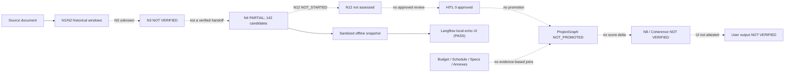

# LF-01 — Verified execution and critical assessment (20 Nov 2026)

**Decision: LAB ONLY / NO C2PRO INTEGRATION.** Isolated Langflow successfully runs a visual diagnostic snapshot echo, but has **NOT demonstrated causal diagnostics of actual N4/N12 execution**. Installation ≠ acceptance of the mission's diagnostic-value goal.

## Evidence matrix

| Item | Result | Evidence / scope |
|---|---|---|
| Latest stable release (as checked 20 Nov) | 1.13.3 | Official release notes; patch release includes security updates |
| Running server | PASS | Rootless Podman `c2pro-lf01`; `/health` HTTP 200, `/` HTTP 200 |
| Access control | PASS for unauthenticated flow listing | `GET /api/v1/flows/` returns 403 |
| Private-only network binding | PASS | `127.0.0.1:17860`, no public port |
| Dedicated service and enforced resource limits | PASS | `lf01-langflow.service`, enabled at boot, `MemoryMax=4294967296`, `CPUQuota=200%`, container PID under service cgroup |
| Real offline **aggregate** diagnostic flow | PASS | Langflow flow `2cf54ed5-6d0b-4645-b408-69693f4ebb27`; official local run API returns HTTP 200 and provenance marker |
| Artificial partial-run diagnostic flow | PASS | Langflow flow `553ab8e3-db5c-4f39-ba0f-ab90b3ff45c9`; HTTP 200 and synthetic marker |
| Graph editor diagram contents | CREATED via authenticated API | Two visual flows, **13 nodes each: 2 executable (ChatInput -> ChatOutput), 11 explanatory note nodes; notes are not executed** |
| Actual C2Pro live read-only API connection | NOT VERIFIED / NOT ATTEMPTED | Owner-only GET only found in unmerged **draft PR #1276**; no approved/deployed endpoint proof, and authentication/tenant scope cannot be bypassed |
| True per-window causal events and N3/N12 handoff | NOT AVAILABLE | Prior offline N4 reconciliation explicitly says historical window states cannot be reconstructed; cannot infer where actual runtime dropped data |
| Real model inference / N12 execution in LF-01 | NONE | No model credentials; zero new inference runs and no contract processing |
| HITL, ProjectGraph, Coherence / production DB writes | NONE | No connectivity or write-capable components |

### Historic offline N4 sample (NOT a new C2Pro run)

Original private inputs retained **only** in the VPS:
- `/home/aigenadmin/c2pro-recovery-evidence-20261117/private-output/n4_offline_audit_metrics.json`
- `/home/aigenadmin/c2pro-recovery-evidence-20261117/private-output/n4_t05_packet_20261120.json`

The privacy-safe aggregate records 142 proposed candidates over 24 historic windows, of which 50 literal strings verified in N2 and 92 were not verified in the available N2 source. These counts are NOT evidence of 142 true risks. N4 status PARTIAL, N12 NOT_STARTED, 0 human approvals, ProjectGraph NOT_PROMOTED, original user 94-page PDF NOT attested. No confirmed Coherence score effect or UI propagation.

Reported blocker categories (gates, **not a proven cause of N4 interruption**):
1. `N4_PARTIAL_SOURCE_COVERAGE`
2. `N12_REAL_PROVIDER_NOT_EXECUTED`
3. `NO_IMMUTABLE_CANDIDATE_ARTIFACT_OR_AUTHENTICATED_REVIEW`
4. `NO_HUMAN_DECISIONS`
5. `USER_94_PAGE_PDF_NOT_ATTESTED`

Synthetic case: 6 planned windows; 3 processed, 1 blocked, 2 unprocessed; 4 synthetic findings, 2 synthetic unresolved refs, synthetic provider timeout. These are illustrative ONLY. N12/HITL/PG not run.

### Visual logic



Dashed links mean conceptual path or unverified actual handoff, **not evidence of successful runtime events**. The actual Langflow execution is the solid offline-snapshot-to-echo path. The visual Langflow stage cards are non-executable notes.

## Operational resources and costs

Measured with `systemctl`, `podman`, and `du` on the existing VPS:
- Runtime ~1.3–1.5 GiB RAM in steady startup measurements; hard ceiling 4 GiB. CPU quota hard ceiling 2 cores.
- Langflow pinned image 2,593,833,965 bytes (~2.59 GB decimal). Rootless image storage ~2.7 GB. Persistent Langflow database ~22 MB.
- Existing VPS capacity 23 GiB RAM, 118 GiB free disk at inspection; no new VM purchased.
- New paid model inference calls: 0. No cloud observability subscription added. Incremental external billing not independently audited. Occupied RAM/disk/CPU and patch maintenance are real operating costs.

## Installation defects corrected during the pilot

1. Docker absent: used rootless Podman with dedicated `lf01lab` user rather than installing a rootful Docker daemon.
2. Missing `newuidmap`: installed Ubuntu `uidmap`, no security controls disabled.
3. Volume ownership: corrected rootless UID mapping with `:U` mount at container creation.
4. Incorrect Fernet key initial format: replaced with random URL-safe base64 of 32 bytes; credentials remain chmod 0600 in local VPS config.
5. Local API run 403: created local-only lab API key, no public auth disable.
6. Imported graph nested edge handles stale: updated both serialized handles to match native component IDs/types.
7. Resource cgroup absent: moved into and enabled dedicated `lf01-langflow.service` with effective systemd `MemoryMax=4G` / `CPUQuota=200%`. Container cgroup verified.

## Access

From an **authorized Tailscale-connected workstation**, use an existing SSH credential:

```bash
ssh -N -L 17860:127.0.0.1:17860 aigenadmin@100.74.108.93
```

Browse `http://127.0.0.1:17860`. Sign in with local username `lf01lab` and the separately protected password in VPS file `/home/lf01lab/lf01-config/.env`. Do not expose the service on the internet, share the password in GitHub, or give Langflow a C2Pro production token.

For repeatable installation: run `sudo bash experiments/lf01/install_vps.sh` from a checkout of the experimental branch; systemd unit template and scripts are adjacent. Then execute `prepare_snapshots.py` against already-authorized private local evidence, `langflow_flow_builder.py`, and `verify_lab.py`.

## Decision rationale / follow-up gate

Langflow proves helpful for **communicating** the pipeline gap and showing evidence classes and missing downstream states. It cannot **trace or repair** existing C2Pro LangGraph runtime with an offline snapshot. LangGraph Studio/ LangSmith are a closer fit for genuine per-node states, handoff traces, token/cost metrics and failures, provided sensitive content is redacted locally and opt-in tracing is authorized.

Maintain isolated sandbox only for brief comparative work; do NOT integrate C2Pro N4/N12, change prompts or add Langfuse. Require a sanitised C2Pro read-only per-window event adapter or existing offline structured trace evidence before a meaningful causal bake-off. Reject the pilot as *diagnostic acceptance completed* until actual N4 results' missing-path cause can be proven. No production PR, deployment, or merge was made.
